# Деревья и структуры данных

Устройство, инварианты и операции в векторных схемах.

## Оглавление

- [1. Как работать с этим учебником](#start)
- [2. Основа понимания деревьев](#base)
- [3. AVL деревья и восстановление высоты](#avl)
- [4. Красно-чёрные деревья через 2–3–4](#rb)
- [5. 2–3–4 деревья и B-деревья](#btree)
- [6. Декартово дерево с явными ключами](#treap)
- [7. Неявное декартово дерево](#implicit)
- [8. Дерево отрезков](#segment)
- [9. Дерево Фенвика](#fenwick)
- [10. Trie и compact trie](#trie)
- [11. PATRICIA как сжатое двоичное trie](#patricia)
- [12. КМП: Z-функция, sp′ и поиск подстроки](#kmp-z-sp)
- [13. От понимания к надёжной реализации](#practice)
- [14. Сравнение и источники для углубления](#summary)

## 1. Как работать с этим учебником

Этот учебник помогает понять, как устроены деревья и что меняется при каждой операции. Сначала разберись, что означает узел и какие состояния допустимы. Затем проследи изменение связей на схемах и объясни, почему после операции структура остаётся корректной. Такой порядок подготавливает к самостоятельной реализации.

Для каждой структуры ответь на четыре вопроса: **что хранится в узле, какой инвариант поддерживается, как проходит операция и от чего зависит её стоимость**. На схемах сначала закрой итоговое состояние и попробуй нарисовать его сам. Затем сравни каждую изменённую связь с рисунком.

> **Общие соглашения.** Индексы последовательностей с нуля, отрезки [l,r), размер r−l. В разделе Фенвика внутри структуры индексы с единицы — это оговорено отдельно. В treap большая величина приоритета находится выше. Ключи множеств уникальны, если явно не сказано иное. Пустое поддерево имеет size=0 и sum=0.

| Вопрос | Подходящая структура | Что организует дерево |
| --- | --- | --- |
| Найти ключ, соседа, k-й ключ | Treap, AVL, красно-чёрное, B-дерево | Порядок ключей |
| Вставить элемент в середину, развернуть фрагмент | Неявный treap | Порядок элементов последовательности |
| Сумма, минимум, изменение фиксированного диапазона | Дерево отрезков | Иерархия интервалов |
| Прибавление в точке и сумма префикса | Фенвик | Двоичное разложение префикса |
| Слова и префиксы | Trie, compact trie, PATRICIA | Общие части ключей |
| Хранение упорядоченных ключей блоками | B-дерево | Много ключей на один узел |

SVG-схемы находятся в соседней папке svg и не требуют сети. При переносе Markdown-файла сохраняй эту папку рядом с ним. Синий узел выделяет текущий объект, зелёный — выбранный результат, красный обозначает красный узел в разделе RB. Цвет дублируется текстом. Схемы показывают локальные фрагменты: отсутствующие дети могут быть опущены, если это прямо указано.

## 2. Основа понимания деревьев

#### Операции и схемы процесса

- **Поиск в BST** — [рисунок 1](#figure-1)

- **Правый и левый повороты** — [рисунок 2](#figure-2)

### Узел и поддерево

Узел — объект в памяти. Ребро — ссылка на другой объект. Поддерево узла включает его самого и всех потомков. Переназначить ссылку left означает поменять принадлежность целого поддерева, а не скопировать все его элементы. Поэтому перемещение тысяч элементов логически иногда требует одной записи указателя.

В бинарном дереве поиска BST все ключи слева меньше ключа узла, справа больше. Это условие относится ко всему поддереву, а не только к двум детям. Симметричный обход left → node → right выдаёт отсортированные ключи. У дерева высоты h поиск стоит O(h); обычное BST может стать цепочкой и дать O(n).

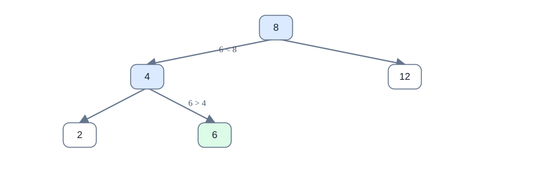

*Рисунок 1. BST и путь поиска 6*

### Инвариант как договор

Инвариант — утверждение, истинное после каждой завершённой операции. Доказательство операции состоит из трёх частей: предусловие, локальное изменение и восстановление договора. Разрешено временно нарушить баланс внутри функции, но наружу должна вернуться корректная структура. Для рекурсивных функций полезно заранее сформулировать, что именно означает возвращаемый корень.

### Поворот сохраняет порядок

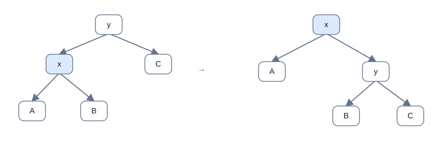

*Рисунок 2. Правый поворот вокруг y: порядок A < x < B < y < C сохраняется*

**Правый поворот состоит из трёх изменений связей.** Левый ребёнок x поднимается на место y. Его прежнее правое поддерево B становится левым поддеревом y, а сам y — правым ребёнком x. Ссылка из внешнего родителя теперь должна вести в x.

Если хранятся ссылки на родителей, обнови их у всех затронутых узлов. Размеры, суммы и высоты пересчитывай сначала у опустившегося y, затем у поднявшегося x: данные верхнего узла зависят от уже исправленного нижнего.

### Агрегаты и два направления работы

**pull(v)** восстанавливает данные узла из детей: size=1+size(left)+size(right), sum=sum(left)+value+sum(right). **push(v)** переносит отложенное действие детям перед спуском. pull идёт снизу вверх, push — сверху вниз. Это разные задачи: pull не заменяет push.

Для суммы нужна ассоциативная операция и нейтральный элемент 0. Для минимума нейтральный элемент +∞. Коммутативность не обязательна: конкатенация строк ассоциативна, но порядок частей менять нельзя. Для вычитания такая схема объединения не работает: (a−b)−c и a−(b−c) различаются.

#### Почему дерево с детьми 4 и 12 у корня 8 всё ещё может нарушать BST?

В правом поддереве 12 может оказаться потомок 3. Проверять нужно границы допустимых ключей для всего поддерева, например (8,+∞).

### Переход по ссылкам во время поворота

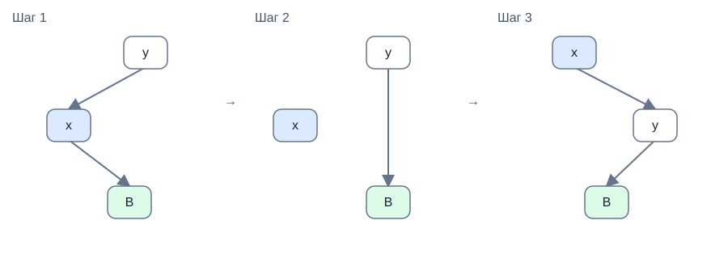

*Рисунок 3. Среднее поддерево B не исчезает, а меняет родителя*

**Шаг 1.** До поворота B — правая ветвь x. Все её ключи больше x и меньше y.

**Шаг 2.** Связь от y к левому ребёнку направляется на B. Узел x удерживаем отдельно, чтобы не потерять его.

**Шаг 3.** Узел y становится правым ребёнком x. Внешняя ссылка на корень фрагмента теперь ведёт в x. Остальные поддеревья здесь опущены.

## 3. AVL деревья и восстановление высоты

**Главная идея AVL:** каждый узел следит за разницей высот своих двух ветвей. Вставка или удаление сначала меняет обычное BST, а повороты возвращают допустимую форму. На схемах проследи, какой узел поднимается и куда переходит среднее поддерево.

#### Операции и схемы процесса

- **Поиск ключа** — [рисунок 12](#figure-12)

- **Предшественник и преемник** — [рисунок 13](#figure-13)

- **Вставка** — [рисунок 10](#figure-10)

- **Одиночный правый поворот LL** — [рисунок 5](#figure-5)

- **Одиночный левый поворот RR** — [рисунок 6](#figure-6)

- **Двойной поворот LR** — [рисунок 7](#figure-7)

- **Двойной поворот RL** — [рисунок 8](#figure-8)

- **Удаление листа и балансировка** — [рисунок 9](#figure-9)

- **Удаление узла с одним ребёнком** — [рисунок 15](#figure-15)

- **Удаление узла с двумя детьми** — [рисунок 14](#figure-14)

- **Пересчёт высоты** — [рисунок 10](#figure-10)

AVL — бинарное дерево поиска, в котором для каждого узла высоты левого и правого поддеревьев различаются не более чем на один. Ограничение действует в каждом узле, а не только в корне. Поэтому длинная односторонняя цепочка запрещена. В отличие от treap, здесь нет случайных приоритетов: форма исправляется по фактическим высотам.

### Высота и знак баланса

> В этом разделе h(null)=0, h(листа)=1. Храним height(v)=1+max(h(left),h(right)) и balance(v)=h(left)−h(right). Положительный баланс означает перевес влево. Допустимы −1, 0, +1. В источниках встречается противоположный знак: вместе с ним зеркально меняются проверки в коде.

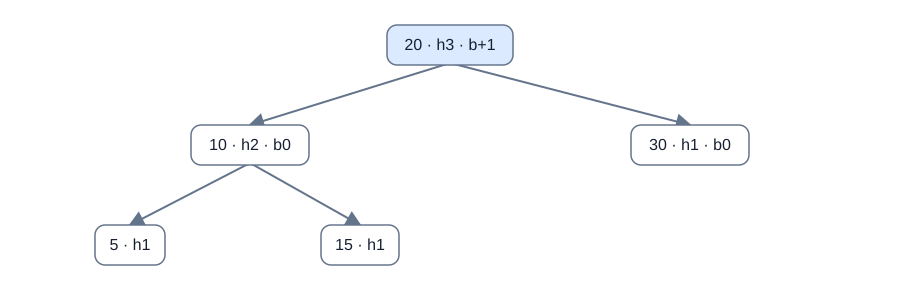

*Рисунок 4. Условие AVL: слева высота 2, справа высота 1, баланс корня +1*

Высота — длина самого длинного пути вниз, а не число узлов поддерева. У двух поддеревьев с одинаковой высотой может быть разное число элементов. Size нужен для k-го элемента; height нужен для восстановления AVL. Одно поле не заменяет другое.

### Откуда берётся логарифмическая высота

Пусть N(h) — минимальное число узлов AVL высоты h. N(0)=0, N(1)=1. Чтобы получить минимальное дерево высоты h, один ребёнок должен иметь высоту h−1, другой хотя бы h−2. Поэтому N(h)=1+N(h−1)+N(h−2): первые значения 0,1,2,4,7,12,20. Это рост по типу чисел Фибоначчи, экспоненциальный по h. Следовательно, h=O(log n). Поиск, вставка и удаление имеют O(log n) в худшем случае, память O(n).

### Четыре формы нарушения

После изменения одного ребёнка его высота меняется не более чем на один. Если до операции всё было корректно, при подъёме может возникнуть только баланс +2 или −2. Имя LL, LR, RR, RL описывает сторону тяжёлого ребёнка и сторону его тяжёлого поддерева. Для выбора исправления после удаления смотри именно высоты и balance, а не сравнение с удалённым ключом.

| Баланс v | Баланс тяжёлого ребёнка | Исправление |
| --- | --- | --- |
| +2 | balance(left) ≥ 0 | LL: один правый поворот v |
| +2 | balance(left) < 0 | LR: левый поворот left, затем правый v |
| −2 | balance(right) ≤ 0 | RR: один левый поворот v |
| −2 | balance(right) > 0 | RL: правый поворот right, затем левый v |

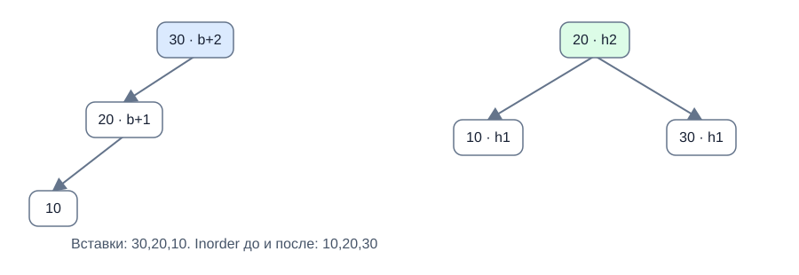

*Рисунок 5. LL после вставки 10: правый поворот вокруг 30*

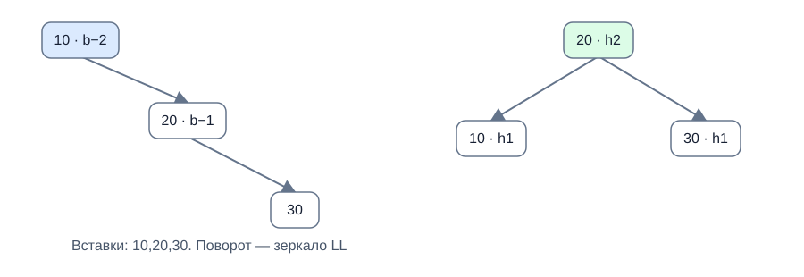

*Рисунок 6. RR после вставки 30: левый поворот вокруг 10*

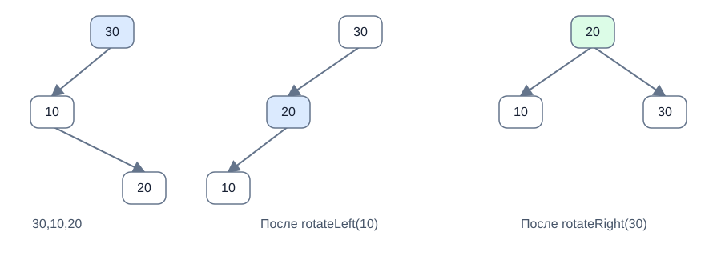

*Рисунок 7. LR: сначала левый поворот 10, затем правый поворот 30*

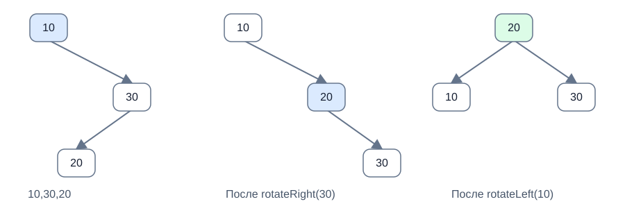

*Рисунок 8. RL: сначала правый поворот 30, затем левый поворот 10*

### Что происходит со средним поддеревом

В настоящем дереве поворот переставляет не три отдельных числа, а связи между поддеревьями. Для правого поворота y: x=y.left, B=x.right; затем y.left=B, x.right=y. Все ключи B лежат между x.key и y.key, поэтому B становится левым поддеревом y без нарушения BST. Сначала обнови height(y), затем height(x). Если поменять этот порядок, x прочитает старую высоту y.

### Что хранить в узле и что возвращает поворот

Узел хранит ключ, высоту и две дочерние ссылки. После локального изменения структура возвращает новый корень фрагмента. Родитель обязан направить свою ссылку на этот новый корень; при повороте всего дерева обновляется его внешний корень. Повторный ключ при работе с множеством не добавляется.

### Вставка снизу вверх

**Вставки 30,10,20**

1. Создать 30: h=1. Вставить 10 слева: у 30 h=2, balance=+1, поворот не нужен.

2. Вставить 20 справа от 10. На возврате у 10 h=2, balance=−1.

3. У 30 h(left)=2, h(right)=0: balance=+2. Левый ребёнок имеет balance=−1: случай LR.

4. Сначала повернуть узел 10 влево, затем узел 30 вправо. Новым корнем становится 20, его дети 10 и 30 — листья.

5. При AVL-вставке первое исправленное снизу поддерево возвращается к высоте до вставки. Выше новые нарушения уже не появятся; рекурсивный код может безопасно продолжить rebalance при возврате.

### Удаление и случай нулевого баланса ребёнка

Сначала выполни обычное удаление BST. Лист просто отделяется; узел с одним ребёнком заменяется этим ребёнком; для узла с двумя детьми используется преемник из правого поддерева.

После физического удаления проверяй баланс на всём пути к корню. Исправленное поддерево может стать ниже и вызвать нарушение у следующего предка. Поэтому при AVL-удалении повороты иногда нужны на нескольких уровнях; их общее число ограничено O(log n).

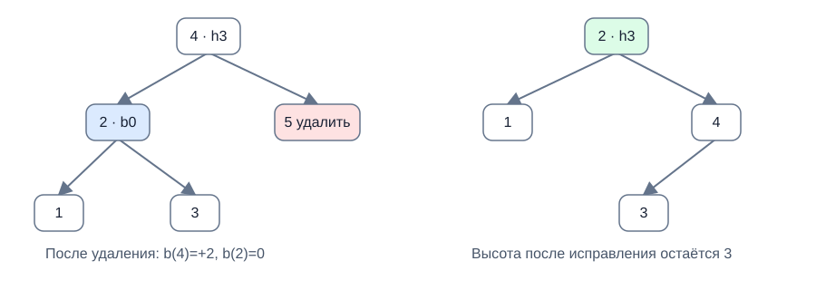

*Рисунок 9. Удаление 5: у тяжёлого ребёнка баланс ноль, нужен один правый поворот*

Нулевой баланс тяжёлого ребёнка относится к случаю одиночного поворота. В показанном примере высота после поворота совпадает с высотой до удаления, поэтому уменьшение высоты не идёт дальше вверх.

В других случаях исправленное поддерево становится ниже: тогда нужно проверить и предков. Выбирай поворот по текущим высотам, а не по величине удалённого ключа: этот ключ уже не описывает форму оставшегося дерева.

### Расширение размера и проверка

Добавить k-й элемент просто: храни size и обновляй его вместе с height в pull; в поворотах сохраняется тот же порядок пересчёта. Для проверки рекурсивно верни вычисленные высоту и размер, проверь строгие границы BST, равенство сохранённой высоты вычисленной и |h(left)−h(right)|≤1. Проверяй эти свойства после каждой вставки и удаления, сравнивая inorder со std::set.

#### Почему цепочка 1→2→3 не является AVL, хотя каждое ребро соблюдает BST?

У корня высоты детей 0 и 2, баланс −2. BST гарантирует порядок, но не ограничивает высоту; AVL добавляет отдельный инвариант баланса.

#### Что делать при balance(v)=−2 и balance(v.right)=0 после удаления?

Один левый поворот вокруг v. Нулевой баланс тяжёлого ребёнка относится к одиночному повороту; двойной нужен только при положительном балансе правого ребёнка.

#### Что произойдёт, если после поворота забыть присвоить возвращённый корень?

Ссылка от родителя или внешний root останется на прежнем верхнем узле. Часть дерева станет недоступной через эту ссылку, хотя локальные поля детей могут быть переставлены правильно.

### Как высота возвращается по пути вставки

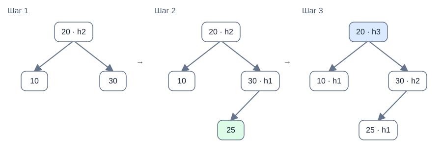

*Рисунок 10. Вставка 25 в AVL: сначала меняется лист, затем высоты предков*

**Шаг 1.** Изначально оба ребёнка корня имеют высоту 1. Высота корня равна 2.

**Шаг 2.** Поиск места вставки идёт через 20 и 30. Новый лист 25 появляется слева от 30. Метки предков на этом промежуточном рисунке ещё старые.

**Шаг 3.** Пересчёт снизу: высота 30 становится 2, высота 20 — 3. У 20 разность высот равна −1, у 30 равна +1. Повороты не нужны: рост высоты сам по себе не является нарушением.

### Два разных исхода удаления

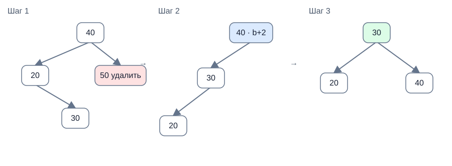

*Рисунок 11. Удаление с перевесом влево: ребёнок наклонён вправо, нужен LR*

**Шаг 1.** Исходный AVL корректен: у 40 слева высота 2, справа 1. После удаления 50 слева становится на два уровня выше.

**Шаг 2.** Левый ребёнок 20 наклонён вправо. Сначала повернуть его влево: теперь слева от 40 стоит 30 с ребёнком 20.

**Шаг 3.** Правый поворот вокруг 40 даёт корень 30 и два листа 20,40. Высота фрагмента уменьшилась с 3 до 2: предкам тоже потребуется проверка.

### Поиск ключа и ближайших соседей

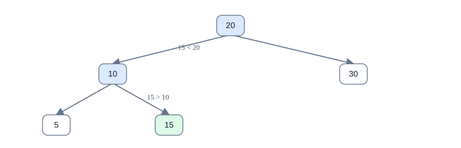

*Рисунок 12. AVL: поиск 15 идёт по сравнениям, баланс не меняется*

**Как читать путь поиска**

1. Сравнить 15 с корнем 20: перейти влево.

2. Сравнить 15 с 10: перейти вправо.

3. Встретить равный ключ 15: найден. Пустая ссылка вместо него означала бы отсутствие. Ни поворот, ни перекраска для поиска не нужны.

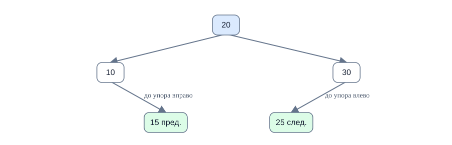

*Рисунок 13. AVL: предшественник и преемник ключа 20*

Предшественник — максимальный ключ слева: идём влево, затем до упора вправо. Преемник — минимальный справа: идём вправо, затем до упора влево. Если нужного поддерева нет, ответ ищется среди предков: для преемника это ближайший предок, к которому путь пришёл слева; для предшественника — справа. При отсутствии такого предка соседа нет. В дереве без родительских ссылок кандидата можно запоминать при спуске от корня.

### Удаление узла с двумя детьми

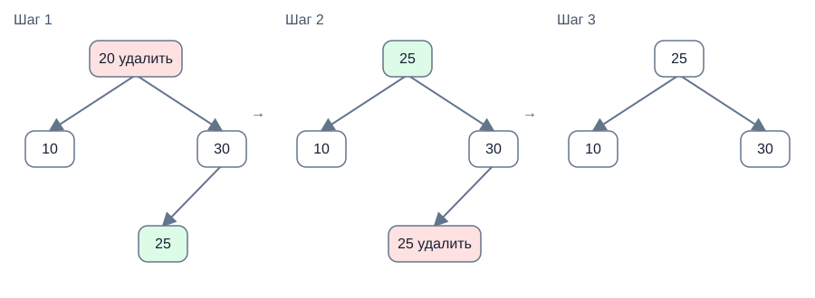

*Рисунок 14. AVL: замена ключа преемником и физическое удаление внизу*

**Шаг 1.** Найти минимальный ключ в правом поддереве: 25. Здесь показан только порядок ключей; цветовые выделения обозначают этап удаления, а не цвета КЧД.

**Шаг 2.** Перенести ключ и связанные данные 25 на место 20. Нижний узел 25 теперь физически лишний. Высоты AVL или цвета КЧД при копировании ключа не переносятся.

**Шаг 3.** Удалить нижний узел и восстановить соответствующий инвариант: для AVL — высоты по пути вверх, для КЧД — чёрную высоту при необходимости. Эта схема показывает BST-часть операции до балансировки.

### Лист и узел с одним ребёнком при удалении AVL

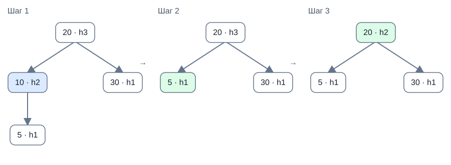

*Рисунок 15. AVL: удалить узел с одним ребёнком и поднять ребёнка*

**Шаг 1.** Удаляем 10: его единственный ребёнок — 5. Переносить ключи по всему поддереву не требуется.

**Шаг 2.** Ссылка из 20 теперь направляется сразу на 5. Если у удаляемого узла детей нет, ссылка вместо этого становится пустой.

**Шаг 3.** Пересчитать высоту 20 и проверить баланс: оба ребёнка имеют высоту 1, корень высоту 2. В этом примере поворот не нужен.

## 4. Красно-чёрные деревья через 2–3–4

**Главная идея КЧД:** цвет кодирует принадлежность ключей одному узлу 2–3–4-дерева. Повороты меняют бинарное представление, перекраски — группировку ключей. При удалении следи за недостающим чёрным уровнем.

#### Операции и схемы процесса

- **Поиск ключа** — [рисунок 25](#figure-25)

- **Предшественник и преемник** — [рисунок 26](#figure-26)

- **Вставка и поворот** — [рисунок 17](#figure-17)

- **Вставка с красным дядей** — [рисунок 19](#figure-19)

- **Выпрямление зигзага** — [рисунок 22](#figure-22)

- **Удаление узла с двумя детьми** — [рисунок 27](#figure-27)

- **Удаление красного листа** — [рисунок 28](#figure-28)

- **Удаление чёрного с красным ребёнком** — [рисунок 29](#figure-29)

- **Перенос дефицита вверх** — [рисунок 20](#figure-20)

- **Исправление с красным братом** — [рисунок 23](#figure-23)

- **Подготовка через ближнего ребёнка** — [рисунок 24](#figure-24)

- **Финальное исправление через дальнего ребёнка** — [рисунок 21](#figure-21)

Красно-чёрное дерево — бинарное BST, в котором цвет кодирует группировку ключей в многоключевые узлы. Красное ребро связывает ключ с тем же логическим 2–3–4-узлом, чёрное ведёт на следующий логический уровень. Обычно цвет записан в ребёнке: «красный узел» означает красное ребро от его родителя.

### Пять условий

Каждый узел красный или чёрный. Корень чёрный. Все отсутствующие дети NIL считаются чёрными. Красный узел не имеет красного ребёнка. На всех путях от узла до нижних NIL одинаковое число чёрных узлов. В этом разделе при подсчёте black-height исключаем сам исходный узел и включаем конечный NIL — важна единая конвенция.

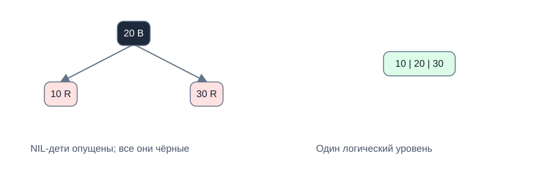

*Рисунок 16. Склеиваем красных детей с чёрным родителем: получаем 4-узел*

Чёрный узел без красных детей соответствует 2-узлу. С одним красным ребёнком — 3-узлу; он может быть слева или справа в обычном RB. С двумя красными — 4-узлу. Отсутствие двух красных подряд ограничивает длину пути: между чёрными уровнями не более одного красного. Поэтому h≤2 log₂(n+1). Не путай обычное RB с LLRB, где накладывают дополнительные ограничения на наклон красных связей.

### Вставка и смысл исправлений

Вставь ключ как в BST, покрась новый узел z красным. Так число чёрных на путях не меняется. Возможная проблема — только красный родитель. Если z стал корнем, покрась его чёрным. Иначе рассматриваем p=parent(z), g=parent(p) и u — второго ребёнка g, «дядю».

| Состояние | Исправление | Смысл |
| --- | --- | --- |
| p чёрный | Готово | Добавили ключ в допустимую группу |
| p и u красные | p,u → чёрные, g → красный; продолжить с z=g | Разделили переполненную группу и передали ключ вверх |
| p красный, u чёрный, z — внутренний внук | Повернуть p, получить внешний случай | Выпрямить зигзаг |
| p красный, u чёрный, z — внешний внук | Поворот g; новый верхний p чёрный, g красный | Перекодировать группу, сохранив порядок и black-height |

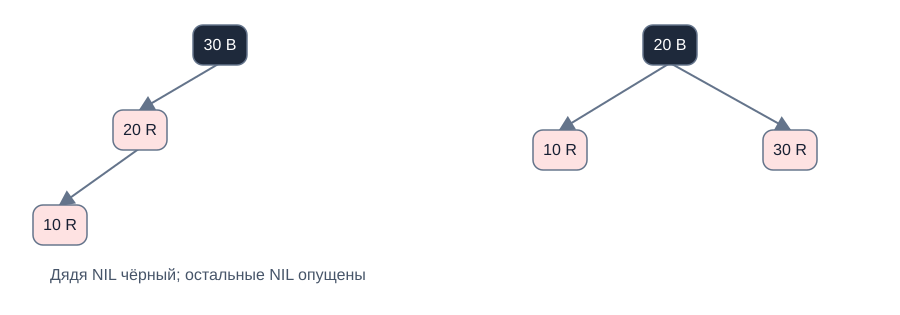

*Рисунок 17. Вставка 10 под 20 под 30: внешний случай и правый поворот*

**Внутренний случай: вставить 20 в дерево 30 B → 10 R**

1. Получается зигзаг: 20 — правый ребёнок левого ребёнка 30.

2. Левый поворот вокруг 10 переводит зигзаг в цепочку 30 → 20 → 10.

3. Покрасить 20 чёрным, 30 красным и повернуть 30 вправо.

4. Итог: чёрный 20 с красными 10 и 30. Для правой стороны всё зеркально.

### Удаление и дефицит чёрной высоты

Если у удаляемого ключа два ребёнка, скопируй ключ и данные преемника в его узел, затем физически удаляй преемника. Для исправления важен исходный цвет **физически вырезанного узла**, а не цвет узла с первоначальным ключом. У физически удаляемого узла не более одного непустого ребёнка.

Удаление красного не меняет black-height. Если удаляется чёрный и его единственный ребёнок красный, покрась ребёнка чёрным. Иначе на позиции x, возможно NIL, появляется дефицит одного чёрного. «Двойной чёрный» — способ рассуждать об этом дефиците, а не обязательное значение enum.

Ниже x — левый ребёнок; w — правый брат. Ближний ребёнок w — w.left, дальний — w.right. Если x справа, поменяй лево и право во всех шагах. Дефицит у корня можно отбросить: все пути уменьшаются одинаково.

| Случай | Изменение | Что дальше |
| --- | --- | --- |
| w красный | w → чёрный, parent → красный; левый поворот parent; обновить w | Свести к случаю чёрного брата |
| w чёрный, оба его ребёнка чёрные | w → красный; перенести дефицит в parent | Если parent красный — покрасить его чёрным и закончить; иначе продолжить выше |
| w чёрный, дальний чёрный, ближний красный | Ближний → чёрный, w → красный; правый поворот w; обновить w | Получить красного дальнего ребёнка |
| w чёрный, дальний красный | w получает цвет parent; parent и дальний → чёрные; левый поворот parent | Дефицит устранён, закончить |

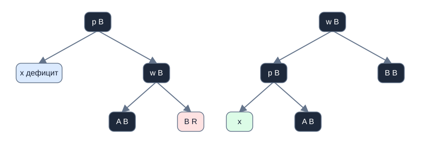

*Рисунок 18. Финальный случай удаления: дефицит x покрывается через красного дальнего ребёнка*

Схема локальная: A и B обозначают корни поддеревьев с согласованными высотами; x может быть пустым. В общем случае p может быть красным: тогда новый корень w получает именно прежний цвет p, а не всегда чёрный. Остальные поддеревья под A, B, x опущены.

### Подготовка к коду

Узел хранит key, color, left, right, parent. Выбери единую стратегию NIL: общий чёрный sentinel или null с передачей родителя отдельно. При sentinel не перекрашивай общий NIL в красный; корректные случаи исправления предполагают реального брата. Повороты обязаны обновлять root и parent. После копирования преемника обновляй полезные данные целиком, но не переноси его цвет в целевой узел.

При подготовке реализации отдельно разбери повороты, замену узла его ребёнком, поиск минимума и восстановление после вставки и удаления. Для каждого случая сначала изучи одну сторону, затем отрази схему зеркально.

Проверяй смысл исправления подсчётом чёрных узлов: сравни пути через позицию дефицита и через её брата до и после изменения. Так становится видно, где дефицит исчезает, а где только перемещается выше.

### Трассировка перекраски с красным дядей

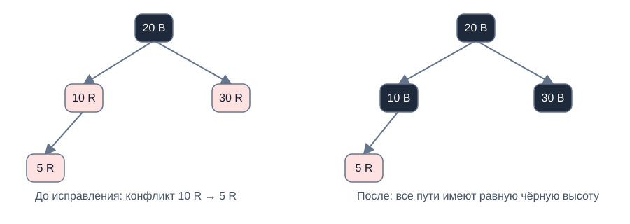

*Рисунок 19. Вставка 5: красные 10 и 30 становятся чёрными, корень остаётся чёрным*

**Почему перекраска работает**

1. Перед вставкой чёрный 20 с двумя красными детьми представляет 4-узел [10|20|30]. Новый 5 добавляется в эту логическую группу.

2. Перекрасить 10 и 30 в чёрный, 20 — в красный. На любом проходящем через группу пути убрали чёрный 20, но добавили чёрный 10 или 30: число чёрных сохранилось.

3. Теперь конфликт может быть только между 20 и его родителем. Продолжить исправление от 20.

4. В нашем примере 20 — корень: покрасить его чёрным и закончить. Чёрная высота всего дерева возрастёт одинаково на всех путях.

### Порядок исправления вставки

Этот вариант использует parent и общий чёрный NIL. rotateLeft/Right меняют root при необходимости и обновляют все parent. После поворота ссылки p и g нужно вычислять заново либо обращаться через z.parent: старые роли узлов уже изменились.

Для безопасного доступа к parent у корня назначь root.parent=NIL, а NIL.color=BLACK. Обычная BST-вставка должна создать z с двумя NIL-детьми и правильным parent. Новый красный корень проходит цикл без обращения к дедушке: его parent чёрный.

### Удаление чёрного листа с переносом дефицита

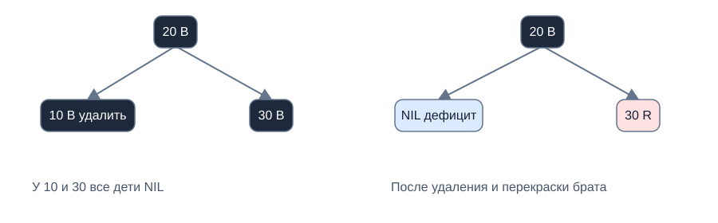

*Рисунок 20. Удалить 10 из корня 20 B с двумя чёрными листьями*

**Где находится недостающий чёрный**

1. Вырезали чёрный 10. На левом пути от 20 теперь на один чёрный меньше. Позиция x — левый NIL.

2. Брат 30 чёрный, оба его ребёнка NIL чёрные. Перекрасить 30 в красный: теперь правый путь тоже потерял один чёрный.

3. Обе стороны под 20 выровнялись, но всё поддерево 20 стало ниже по чёрной высоте. Перенести дефицит в 20.

4. 20 — корень, выше согласовывать нечего. Дефицит отбросить. Итог: 20 B с единственным правым ребёнком 30 R.

### Удаление с заимствованием через дальнего красного ребёнка

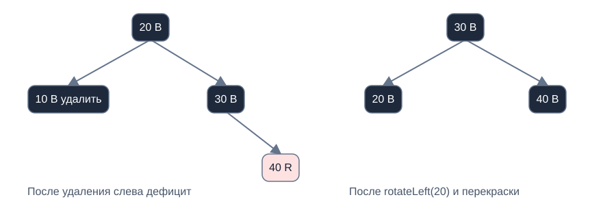

*Рисунок 21. Удалить 10: брат 30 имеет дальнего красного ребёнка 40*

После удаления x=NIL, w=30 B, дальний ребёнок 40 R. Узел 30 получает прежний цвет 20; 20 и 40 становятся чёрными, затем выполняется левый поворот 20. Итоговые пути 30→20→NIL и 30→40→NIL содержат одинаковое число чёрных. При склейке в 2–3–4 это передача ключа из более наполненного соседа через родителя.

### Как спроектировать erase без потери родителя NIL

Для общего sentinel есть два согласованных подхода: transplant временно записывает в NIL.parent родителя текущей позиции дефицита, либо eraseFix получает родителя отдельным параметром. При передаче родителя отдельно его связь с текущей позицией дефицита нужно сохранять явно. Если x реальный, его parent уже обновлён transplant. При перемещении дефицита вверх обновляй и x, и его логического родителя. Не пытайся хранить через общий NIL.parent родителей всех пустых детей одновременно.

### Почему исправление удаления завершается

Красный брат превращается в чёрного одним поворотом. Случай с красным ближним и чёрным дальним ребёнком превращается в финальный одним поворотом. Финальный случай завершает исправление. Только случай двух чёрных детей брата поднимает дефицит выше без поворота. Подъёмов не больше высоты O(log n); в стандартном алгоритме исправления удаления выполняется не больше трёх поворотов. Вставка требует не больше двух, хотя перекраски могут подниматься до корня.

### КЧД и AVL решают одну задачу разными инвариантами

| Свойство | AVL | КЧД | Treap |
| --- | --- | --- | --- |
| Что контролируем | Разницу обычных высот | Цвета и равенство чёрных высот | Порядок случайных приоритетов |
| Гарантия операций | O(log n) в худшем случае | O(log n) в худшем случае | O(log n) в ожидании; O(n) в худшем |
| Информация для баланса | Height или balance factor | Color | Priority |
| Исправление вставки | Один или два поворота на первом нарушении | До двух поворотов; перекраски вверх | Повороты по приоритету либо split/merge |
| Исправление удаления | Может потребовать поворотов на многих уровнях | До трёх поворотов; дефицит может идти вверх | Соединить поддеревья удаляемого узла |
| Полезная мысленная модель | Не позволять одной стороне стать слишком высокой | Кодировать 2–3–4-узлы бинарными связями | Случайный корень каждого упорядоченного фрагмента |

#### После удаления чёрного листа его брат красный. Можно ли сразу окрасить брата в красный как в случае двух чёрных детей?

Нет: брат уже красный, а конфигурация не соответствует этому случаю. Сначала красный брат становится чёрным, родитель красным и выполняется поворот родителя. Затем брат позиции дефицита вычисляется заново.

#### Почему удаление корня с одним красным ребёнком не требует вращений?

Ребёнок становится новым корнем и перекрашивается в чёрный. Потерянный при удалении чёрный уровень компенсирован; все пути снова согласованы.

#### Почему новый узел при вставке красный?

Если сделать его чёрным, только один путь получит дополнительный чёрный уровень. Красная вставка сохраняет black-height; остаётся локально исправить возможные два красных подряд.

### Зигзаг при вставке по отдельным состояниям

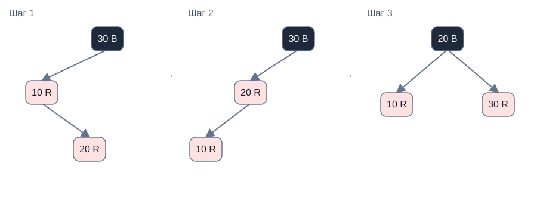

*Рисунок 22. КЧД: внутренний красный внук сначала превращается во внешнего*

**Шаг 1.** У 30 красный левый ребёнок 10, у него красный правый ребёнок 20. Дядя — чёрный NIL. Это зигзаг.

**Шаг 2.** Левый поворот вокруг 10 выпрямляет цепочку. Конфликт красный–красный пока остаётся: этот шаг только меняет форму.

**Шаг 3.** Новый верхний 20 покрасить в чёрный, 30 в красный и повернуть 30 вправо. Теперь красные дети имеют чёрного родителя.

### Красный брат при удалении

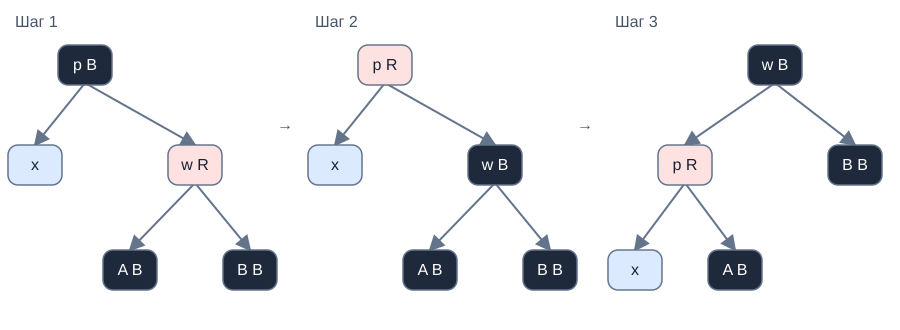

*Рисунок 23. КЧД: красный брат меняется местами по высоте с родителем*

**Шаг 1.** У позиции x не хватает одного чёрного. Брат w красный; следовательно, его дети A и B чёрные. Внутреннее устройство поддеревьев здесь опущено.

**Шаг 2.** Поменять цвета p и w. Пока это промежуточное состояние, ещё требуется поворот.

**Шаг 3.** Левый поворот вокруг p ставит w выше. Братом x теперь является A, уже чёрный. Дефицит x ещё не устранён: дальше выбираем случай по детям нового брата A.

### Ближний красный ребёнок превращается в дальнего

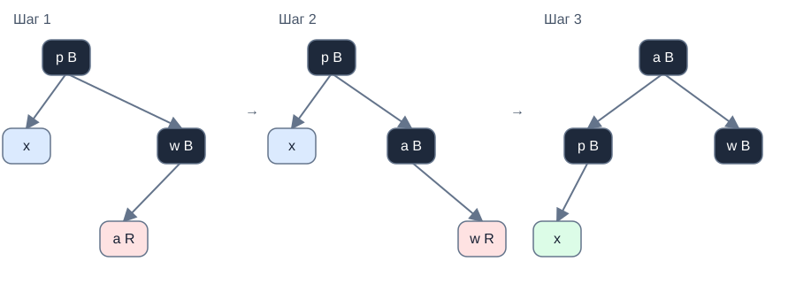

*Рисунок 24. КЧД: подготовительный поворот брата перед финальным исправлением*

**Шаг 1.** x — слева с дефицитом. У чёрного брата w ближний ребёнок a красный, а дальний чёрный и на схеме опущен.

**Шаг 2.** Покрасить a в чёрный, w в красный, повернуть w вправо. Новый брат x — a; теперь у него есть дальний красный ребёнок w.

**Шаг 3.** Выполнить финальное исправление: a получает прежний цвет p, p и w становятся чёрными, p поворачивается влево. Дефицит устранён. Не показанные поддеревья переносятся по правилу обычного поворота.

### Поиск ключа и ближайших соседей

*Рисунок 25. КЧД: поиск 15 идёт по сравнениям, баланс не меняется*

**Как читать путь поиска**

1. Сравнить 15 с корнем 20: перейти влево.

2. Сравнить 15 с 10: перейти вправо.

3. Встретить равный ключ 15: найден. Пустая ссылка вместо него означала бы отсутствие. Ни поворот, ни перекраска для поиска не нужны.

*Рисунок 26. КЧД: предшественник и преемник ключа 20*

Предшественник — максимальный ключ слева: идём влево, затем до упора вправо. Преемник — минимальный справа: идём вправо, затем до упора влево. Если нужного поддерева нет, ответ ищется среди предков: для преемника это ближайший предок, к которому путь пришёл слева; для предшественника — справа. При отсутствии такого предка соседа нет. В дереве без родительских ссылок кандидата можно запоминать при спуске от корня.

### Удаление узла с двумя детьми

*Рисунок 27. КЧД: замена ключа преемником и физическое удаление внизу*

**Шаг 1.** Найти минимальный ключ в правом поддереве: 25. Здесь показан только порядок ключей; цветовые выделения обозначают этап удаления, а не цвета КЧД.

**Шаг 2.** Перенести ключ и связанные данные 25 на место 20. Нижний узел 25 теперь физически лишний. Высоты AVL или цвета КЧД при копировании ключа не переносятся.

**Шаг 3.** Удалить нижний узел и восстановить соответствующий инвариант: для AVL — высоты по пути вверх, для КЧД — чёрную высоту при необходимости. Эта схема показывает BST-часть операции до балансировки.

### Удаление без сложного восстановления КЧД

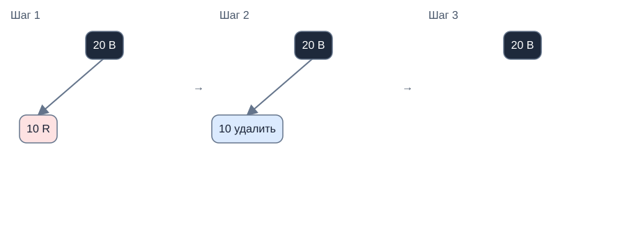

*Рисунок 28. КЧД: удаление красного листа не меняет чёрную высоту*

**Шаг 1.** Корень 20 чёрный, его единственный непустой ребёнок 10 красный. Пустые NIL-дети на рисунке не показаны.

**Шаг 2.** Удаляемый красный лист не вносит чёрного уровня ни в один путь.

**Шаг 3.** Убрать его связь. Все пути по-прежнему содержат равное число чёрных узлов, исправления не нужны.

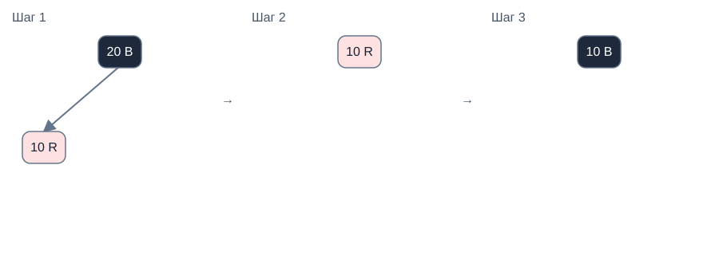

*Рисунок 29. КЧД: чёрный узел с одним красным ребёнком заменяется ребёнком*

**Шаг 1.** Удаляем чёрный корень 20, у которого один красный ребёнок 10.

**Шаг 2.** Ребёнок занимает место удалённого узла. Если остановиться сейчас, один чёрный уровень будет потерян.

**Шаг 3.** Покрасить заменяющий узел в чёрный. Восстановление закончено без поворотов. Для некорневого фрагмента правило то же при корректном окружении.

## 5. 2–3–4 деревья и B-деревья

**Главная идея B-дерева:** один узел хранит несколько ключей и разделяет несколько диапазонов. Высота мала благодаря широким узлам, а все листья находятся на одной глубине. Переполнение исправляется разделением, нехватка ключей — заимствованием или слиянием.

#### Операции и схемы процесса

- **Поиск ключа** — [рисунок 37](#figure-37)

- **Разделение полного корня** — [рисунок 31](#figure-31)

- **Разделение ребёнка и вставка** — [рисунок 34](#figure-34)

- **Заимствование слева** — [рисунок 32](#figure-32)

- **Заимствование справа и удаление из листа** — [рисунок 35](#figure-35)

- **Слияние и уменьшение корня** — [рисунок 33](#figure-33)

- **Слияние без уменьшения высоты** — [рисунок 36](#figure-36)

- **Удаление внутреннего ключа** — [рисунок 38](#figure-38)

В многопутевом дереве поиска узел содержит несколько упорядоченных ключей k0<k1<… и на один дочерний интервал больше. Для [10|20] ребёнок 0 хранит ключи <10, ребёнок 1 — между 10 и 20, ребёнок 2 — >20. Все листья находятся на одинаковой глубине. Баланс достигается регулированием заполненности, а не вращениями одиночных ключей.

![30. Узел \[10|20\] разделяет три диапазона](svg/30.svg)

*Рисунок 30. Узел [10|20] разделяет три диапазона*

### Точный контракт B-дерева

Используем минимальную степень t≥2, как в распространённом учебном определении. Некорневой узел содержит от t−1 до 2t−1 ключей. Внутренний узел с k ключами имеет k+1 детей, то есть от t до 2t. Непустой корень содержит хотя бы один ключ; пустое дерево можно представить пустым корнем-листом. Корень — единственное исключение по минимальной заполненности.

2–3–4-дерево — случай t=2: 2-узел имеет 1 ключ и 2 ребёнка, 3-узел — 2 ключа и 3 ребёнка, 4-узел — 3 ключа и 4 ребёнка. Название считает детей, не ключи; для листьев это тип узла по числу ключей, фактических детей у них ноль. Термин «порядок B-дерева» неоднозначен: иногда означает максимум детей, поэтому не заменяй им t без определения.

### Поиск

Найди первый ключ узла ≥x. Если он равен x, поиск завершён. Если узел — лист, ключ отсутствует. Иначе спустись в ребёнка с тем же индексом. Поиск внутри узла можно делать линейно за O(t) или бинарно за O(log t); число уровней O(log_t n). Для дискового хранения узел выбирают размером около блока, чтобы один уровень стоил одно чтение блока.

### Split полного ребёнка при вставке

В полном узле 2t−1 ключей выбери медиану с индексом t−1. Она поднимается в родителя; слева остаются t−1 ключей, справа t−1. Если узел внутренний, первые t детей идут в левую часть, последние t — в правую. Обе части остаются на той же глубине.

![31. t=2: разделить полный корень \[10|20|30\], затем вставить 25](svg/31.svg)

*Рисунок 31. t=2: разделить полный корень [10|20|30], затем вставить 25*

На рисунке вертикальная стрелка «вставить 25» показывает смену состояния листа, а не дополнительное ребро итогового дерева. Итоговый корень 20 имеет два листа: [10] и [25|30].

**Вставка сверху вниз**

1. Если корень полон, создать новый пустой корень с единственным ребёнком — старым корнем — и разделить ребёнка.

2. В неполном внутреннем узле выбрать ребёнка по ключу. Если ребёнок полон, сначала разделить его; сравнить x с поднятой медианой и выбрать правильную половину.

3. Спускаться только в неполного ребёнка. В листе сдвинуть ключи и вставить x на место.

4. Повторный ключ обрабатывать согласно выбранному контракту. Для множества удобна предварительная проверка отсутствия: иначе ненужный split может менять форму даже при отказе от вставки.

### Удаление без недополнения на обратном пути

Главный приём: перед спуском обеспечь у выбранного ребёнка хотя бы t ключей. Тогда удаление одного ключа внизу не оставит запрещённые t−2. У корня есть отдельное правило уменьшения высоты.

| Где найден ключ / куда спускаемся | Действие |
| --- | --- |
| Ключ в листе | Удалить и сдвинуть хвост |
| Ключ во внутреннем узле, левый соседний ребёнок содержит ≥t ключей | Заменить ключ предшественником, рекурсивно удалить предшественник слева |
| Левый минимален, правый содержит ≥t | Заменить преемником, рекурсивно удалить справа |
| Оба соседних ребёнка содержат t−1 | Слить левый + разделитель родителя + правый, удалить ключ в полученном узле |
| Ключ не найден в узле, выбранный ребёнок минимален, сосед имеет ≥t | Занять через родителя: ключ родителя вниз, крайний ключ соседа вверх |
| Выбранный ребёнок минимален, оба доступных соседа минимальны | Слить с одним соседом через разделитель родителя и спуститься в результат |

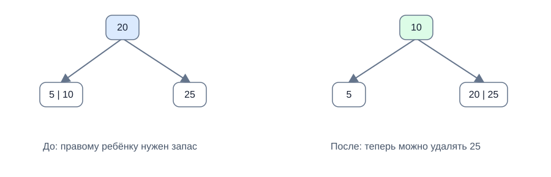

*Рисунок 32. Заимствование слева: разделитель 20 идёт вниз, 10 поднимается*

Для внутреннего левого соседа его последний ребёнок также переносится и становится первым ребёнком получателя. При заимствовании справа симметрично переносится первый ребёнок соседа в конец получателя. Переместить только ключи и забыть детей — распространённая ошибка.

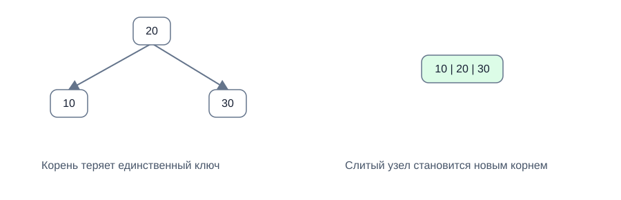

*Рисунок 33. Слияние двух минимальных детей через ключ родителя*

После удаления, если корень внутренний и опустел, замени его единственным ребёнком. Так высота уменьшается на единицу. Если опустел корень-лист, дерево пустое. При слиянии с левым соседом индекс ребёнка меняется на i−1; нельзя продолжить рекурсию по старому i.

**Удалить 10 из дерева корень [20], листья [10] и [30]**

1. Ребёнок [10] минимален (t−1=1); сосед [30] тоже минимален, заимствовать нельзя.

2. Слить [10], ключ 20 и [30] → [10|20|30]. Корень временно пуст.

3. Удалить 10 из слитого листа → [20|30].

4. Заменить пустой корень единственным ребёнком. Получился один лист [20|30].

### Оценки и B плюс

При высоте h по рёбрам и непустом дереве минимальное число ключей n≥2t^h−1, откуда h≤log_t((n+1)/2). Поиск требует O(log_t n) посещений узлов. В RAM вставка и удаление сдвигают до O(t) ключей на уровень, поэтому стандартная оценка O(t log_t n); при постоянном t — O(log n). Память O(n).

В B-дереве записи могут лежать во внутренних узлах. В B+ дереве полезные записи обычно лежат в листьях, внутренние ключи служат разделителями, листья связаны для диапазонного обхода. Правила копирования и подъёма разделителей отличаются; нельзя смешивать split B и B+ в одной реализации.

#### Почему при split узла высота всех листьев не меняется, кроме split корня?

Один узел заменяется двумя на том же уровне, а медиана переезжает в уже существующего родителя. Только новый корень создаёт дополнительный уровень сразу над всеми листьями.

### Разделение ребёнка внутри существующего родителя

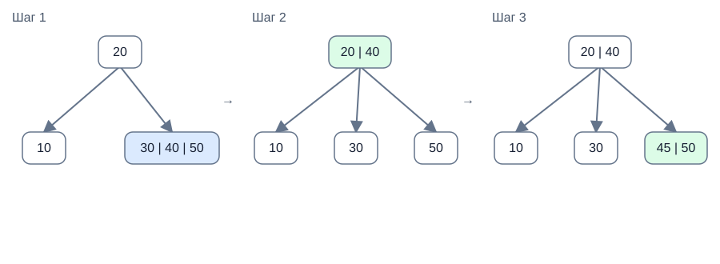

*Рисунок 34. B-дерево степени 2: медиана 40 занимает место в родителе*

**Шаг 1.** Чтобы вставить 45, поиск ведёт вправо от 20. Выбранный ребёнок полон: сначала его нужно разделить.

**Шаг 2.** Медиана 40 поднимается в родителя. Узел [30] становится средним ребёнком, [50] — правым. Глубина листьев не меняется.

**Шаг 3.** 45 больше поднятого 40, поэтому вставляется в правый лист. Итог: родитель [20|40], дети [10], [30], [45|50].

### Заимствование справа по шагам

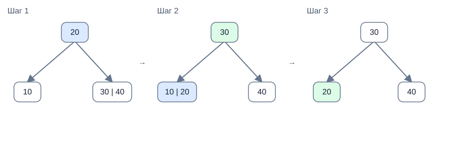

*Рисунок 35. B-дерево: разделитель опускается к бедному ребёнку, ключ соседа поднимается*

**Шаг 1.** Нужно удалить 10. Его лист имеет минимальное число ключей, но правый сосед содержит два и может отдать один.

**Шаг 2.** 20 из родителя опускается в левый лист. Минимальный ключ правого соседа 30 поднимается в родителя.

**Шаг 3.** Теперь левый лист имеет запас: удалить 10 безопасно. Для внутренних узлов вместе с ключом из правого соседа перемещается его крайний левый ребёнок.

### Слияние не обязательно уменьшает высоту

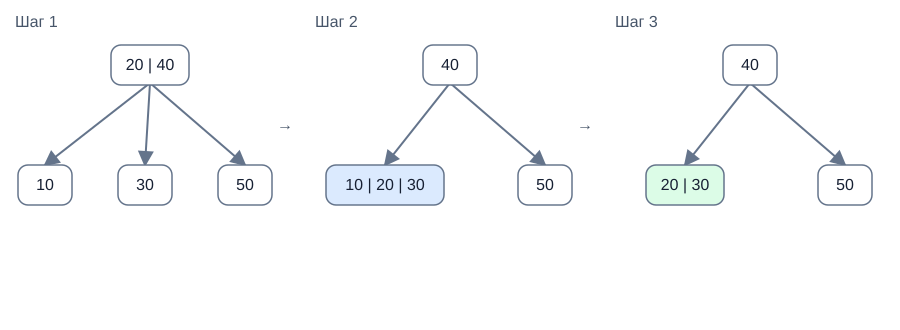

*Рисунок 36. B-дерево: родитель с двумя ключами теряет один разделитель*

**Шаг 1.** Перед удалением 10 левый ребёнок и его сосед минимальны: занять неоткуда.

**Шаг 2.** Слить [10], разделитель 20 и [30]. Родитель остаётся непустым: в нём ещё есть 40, поэтому он сохраняется.

**Шаг 3.** Удалить 10 из объединённого листа. Высота не изменилась. Она уменьшается только тогда, когда после слияния опустел корень.

### Поиск в многоключевом узле

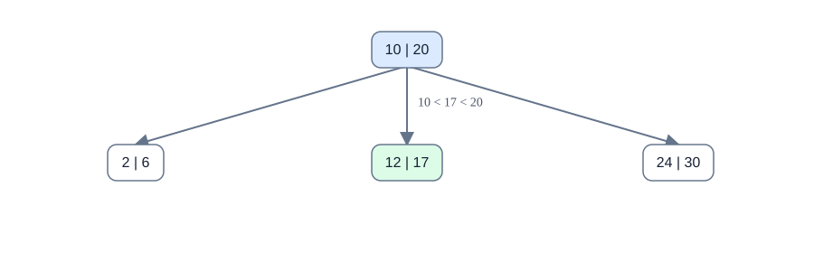

*Рисунок 37. B-дерево: поиск 17 выбирает интервал между 10 и 20*

В корне равного ключа нет. Первым ключом не меньше 17 является 20: выбрать ребёнка непосредственно перед ним, то есть средний. В нём сравнить с 12, затем с 17 — ключ найден. При неудачном поиске в листе возвращаем отсутствие.

### Удаление ключа, лежащего внутри дерева

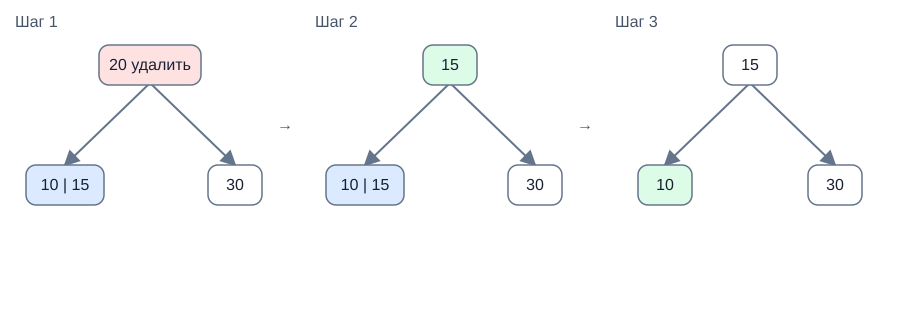

*Рисунок 38. B-дерево: заменить внутренний 20 предшественником 15*

**Шаг 1.** В левом ребёнке есть запас: два ключа при минимуме один. Предшественник 20 — наибольший ключ слева, то есть 15.

**Шаг 2.** Заменить разделитель 20 на 15. На промежуточном рисунке ключ 15 ещё есть и в листе, но итоговая операция обязана убрать эту копию.

**Шаг 3.** Удалить 15 из левого листа. В нём остаётся допустимый один ключ 10. Если запас имеется справа, зеркально используется преемник.

## 6. Декартово дерево с явными ключами

**Главная идея treap:** ключ определяет порядок элементов, случайный приоритет — форму дерева. Два основных действия, split и merge, позволяют перестраивать целые упорядоченные части через изменение нескольких ссылок.

#### Операции и схемы процесса

- **Поиск ключа** — [рисунок 45](#figure-45)

- **Предшественник и преемник** — [рисунок 46](#figure-46)

- **Split по ключу** — [рисунок 40](#figure-40)

- **Merge** — [рисунок 43](#figure-43)

- **Вставка** — [рисунок 41](#figure-41)

- **Удаление** — [рисунок 44](#figure-44)

- **k-й элемент** — [рисунок 47](#figure-47)

- **Ранг** — [рисунок 48](#figure-48)

- **Линейное построение** — [рисунок 49](#figure-49)

- **Передача отложенного обещания push** — [рисунок 42](#figure-42)

- **Восстановление суммы pull** — [рисунок 42](#figure-42)

Treap совмещает два порядка: по key это BST, по priority — max-heap. Ключ отвечает за смысл поиска, случайный приоритет — за форму дерева. При уникальных ключах и приоритетах форма единственна: корень обязан иметь наибольший приоритет, ключи меньше него рекурсивно образуют левую часть, остальные правую.

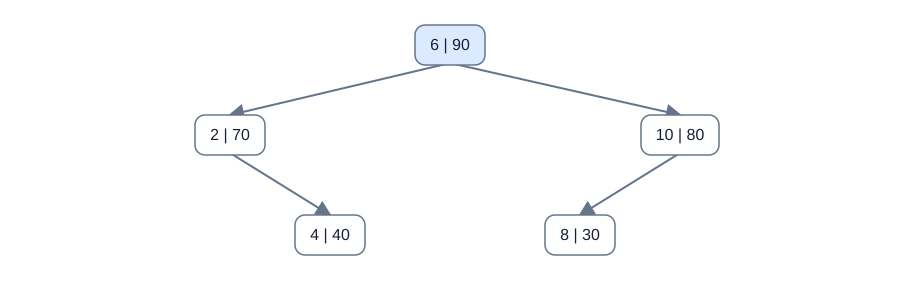

*Рисунок 39. Пары key | priority: inorder 2, 4, 6, 8, 10*

Почему высота мала в среднем: наибольший из независимых случайных приоритетов одинаково вероятно принадлежит любому ключу. Корень играет роль случайно выбранного разделителя, затем тот же принцип действует в частях. Ожидаемые время поиска, вставки, удаления и высота — O(log n); худший случай O(n). Это вероятностная гарантия, а не строгий баланс высот. Используй широкие случайные приоритеты и однозначное разрешение совпадений.

### Split по ключу

split(T,x) возвращает (A,B), где в A ключи <x, в B ключи ≥x. Это разрез упорядоченного обхода; он не пересоздаёт узлы. Посещается только путь, на котором лежала бы граница x.

**Трассировка split(T,7) на рисунке**

1. 6<7: корень 6 останется в A. Разрезать нужно только его правое поддерево 10.

2. 10≥7: узел 10 останется в B. Разрезаем его левое поддерево 8.

3. 8≥7: разрезаем пустого левого ребёнка 8 и получаем (∅,∅). Узел 8 остаётся в B.

4. У 10 левый ребёнок снова 8. У 6 правый ребёнок становится пустым. Поддерево 2 вообще не трогаем. После каждой замены ссылки вызываем pull.

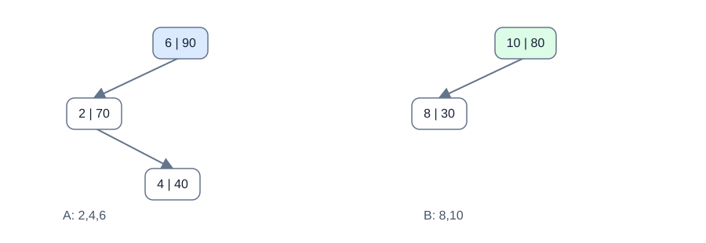

*Рисунок 40. После split по 7: слева ключи <7, справа ключи ≥7*

### Merge двух упорядоченных частей

Предусловие: каждый ключ A меньше каждого ключа B. Сравни приоритеты корней. Более приоритетный обязан стать корнем результата. Если это A, его левое поддерево уже подходит; нужно соединить A.right с B. Если это B, соединяем A с B.left. В конце pull. Передавать произвольные два множества нельзя.

### Вставка и удаление

**Вставка начинается с проверки дубликата.** Раздели дерево по новому ключу: меньшие ключи окажутся слева, большие — справа. Создай один узел со случайным приоритетом и последовательно соедини левую часть, новый узел и правую часть. Выбор корней при слиянии сам определит, на какой высоте окажется новый узел.

Другой способ — вставить ключ как в обычное BST, а затем поднимать его поворотами, пока порядок приоритетов не восстановится. Оба способа поддерживают те же инварианты.

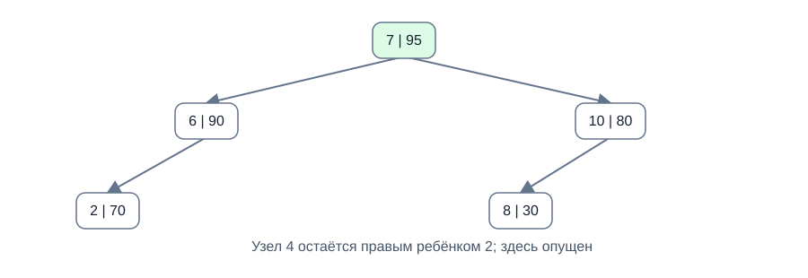

*Рисунок 41. Вставка 7 с приоритетом 95: новый корень, порядок ключей тот же*

**Удаление сохраняет оба поддерева найденного узла.** Найди ключ обычным поиском, соедини его левое и правое поддеревья и поставь результат на место удаляемого узла. Это допустимо: все ключи левой части меньше всех ключей правой. На обратном пути пересчитай агрегаты предков.

Для мультимножества можно хранить число повторений в одном узле и учитывать его в размере. При выделении одного целочисленного ключа не используй границу «ключ плюс один» без проверки: у максимального значения она переполнится.

### Ранг и k-й элемент

**k-й элемент ищется по размерам поддеревьев.** Пусть слева L элементов, а номера начинаются с нуля. Тогда текущий узел имеет локальный номер L. Меньший номер ищи слева; при равенстве ответ найден; для большего номера перейди вправо, вычтя L + 1.

**Ранг x** — количество ключей строго меньше x. Если текущий ключ меньше x, сразу учти его и всё левое поддерево, затем продолжи справа. Иначе продолжи слева. При случайных приоритетах обе операции занимают O(log n) в ожидании.

### Линейное построение из отсортированных ключей

Используй монотонный стек по убыванию приоритета. Для очередного v извлекай вершины с меньшим приоритетом, запоминая последний извлечённый узел last. Сделай v.left=last. Если стек не пуст, stack.top.right=v. Положи v в стек. Корень — нижний элемент стека. После построения пересчитай агрегаты postorder. Каждый узел один раз входит и выходит: O(n). Это построение не делает плохие заданные приоритеты случайными.

> **Контракт перед кодом.** Node хранит key, priority, left, right, size; приоритет генерируется один раз и не меняется. Все операции возвращают новый корень. Проверяй inorder, heap-порядок и size. Не используй адреса элементов vector как стабильные указатели, если vector может перераспределиться: храни индексы или обеспечь стабильное размещение.

### Promise как обещание функции и отложенной операции

Словом promise здесь будем называть явно сформулированное обещание: что функция гарантирует вызывающему коду и какое изменение уже учтено логически, но ещё не передано потомкам. Это учебное обозначение контракта и ленивого действия; отдельного общепринятого примитива treap с названием promise нет. Два смысла полезно разделять: контракт описывает результат функции, lazy-tag хранит ещё не выполненную на детях работу.

### Что именно обещают split и merge

| Функция | Что нужно до вызова | Что гарантируется после |
| --- | --- | --- |
| split(T,x) | Корректный treap, уникальные ключи | A содержит все и только ключи <x; B — все и только ключи ≥x; оба корректны; узлы не потеряны и не дублированы |
| merge(A,B) | Оба дерева корректны; любой ключ A меньше любого ключа B; деревья не имеют общих узлов | Результат корректен и содержит ровно объединение узлов A и B |
| splitPos(T,k) | Корректный неявный treap; 0≤k≤size(T) | A представляет первые k элементов, B — оставшиеся; порядок внутри каждой части сохранён |
| pull(v) | Дочерние ссылки уже окончательные для этого шага; данные детей логически актуальны; у v нет непереданного действия, несовместимого с пересчётом | Size и агрегат v соответствуют текущим детям и собственному значению |
| push(v) | Агрегат v уже учитывает его отложенные действия | Обещанные действия учтены у непосредственных детей; соответствующие флаги v очищены; логическая последовательность не изменилась |

Эти обещания дают способ читать рекурсию без попытки удержать в голове весь стек. В split при t.key<x доверяем рекурсивному split(t.right,x): он возвращает a с ключами <x и b с ключами ≥x. Подставляем a в t.right. Почему это законно? Все ключи a пришли из прежнего правого поддерева, значит всё ещё больше t.key. Остальные ключи t слева меньше t.key и тем более меньше x. После pull узел t — корректный корень всей левой части результата.

Для merge с более приоритетным корнем a доверяем рекурсивному merge(a.right,b). Все его ключи больше a.key; приоритеты корней исходных частей не превосходят a.priority. Поэтому результат можно целиком подвесить справа от a. Это и есть применение обещания рекурсивного вызова: не нужно заново доказывать внутреннее устройство уже возвращённого поддерева.

### Отложенное действие как обещание детям

В неявном treap можно изменить целый выделенный диапазон за O(1) локально: сразу исправить value и sum у его корня, а детям оставить флаг add. Данные корня уже правильны. Флаг означает «перед тем как заглядывать глубже, прибавь это же число каждому ребёнку». Это не фоновая задача: ничего не выполняется само по себе между вызовами. Работа происходит в push при следующем спуске.

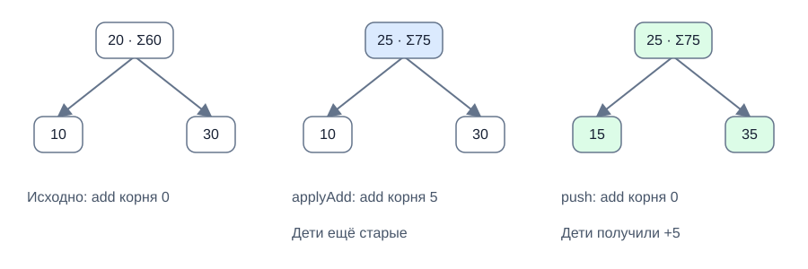

*Рисунок 42. Обещание +5 для последовательности 10,20,30*

После applyAdd корень имеет value=25 и sum=75, но непосредственные дети пока 10 и 30. Поэтому 10+25+30=65 временно не равно sum корня: недостающие 10 уже обещаны двум детям. Если сейчас выполнить обычный pull без push, сумма испортится до 65. После push дети становятся 15 и 35, их собственные lazy-флаги получают +5; теперь pull даёт 15+25+35=75. Флаги у листьев можно оставить до их посещения: потомков у них нет.

### Почему push должен быть до изменения ссылок

Пусть у a есть обещание прибавить 5 прежнему поддереву. Если сначала присоединить новый b через merge, а потом передать обещание детям, прибавление может затронуть элементы b, которые не входили в исходный диапазон. Если split сначала отрежет часть детей, а затем push, отрезанная часть может вообще не получить изменение. Правильный порядок: **push → выбор стороны и рекурсия → замена ссылки → pull**.

Для add и reverse порядок передачи между собой не влияет на значения: прибавление одинаковой константы совместимо с разворотом. Но порядок относительно split/merge принципиален. Для set и add даже взаимный порядок самих действий важен; их композиция разобрана в разделе дерева отрезков и аналогично применяется к поддереву treap с его size.

**Прибавить 5 на [l,r), затем запросить элемент внутри**

1. Двумя splitPos выделить B длины r−l.

2. Выполнить applyAdd(B,5): корень B сразу хранит новую сумму, потомки могут ещё хранить старые значения.

3. Собрать дерево через mergeLazy. Каждый спуск перед изменением ссылок передаёт обещание вниз.

4. При поиске позиции на каждом посещённом узле делать push. Найденное value тогда уже учитывает все обещания предков. Непосещённые ветви можно оставить ленивыми.

#### Есть add=5 у корня с тремя элементами. Можно ли в push ещё раз прибавить 15 к sum корня?

Нет. Эти 15 уже добавлены в applyAdd. push передаёт обязательство детям и очищает флаг, не меняя логическое значение суммы корня.

#### Почему merge требует отсутствия общих узлов у A и B?

Это разрушающая перестройка ссылок. Если части разделяют один объект, можно создать цикл, включить элемент дважды и позднее дважды освободить память. После split пользуйся возвращёнными частями как отдельными владельцами.

#### Может ли split нарушить порядок приоритетов?

Нет. Мы удаляем некоторые связи и подставляем вместо ребёнка корень части его прежнего поддерева. Приоритет такого потомка не выше приоритета текущего узла. Рекурсивные части уже удовлетворяют инварианту.

### Как merge выбирает новый корень

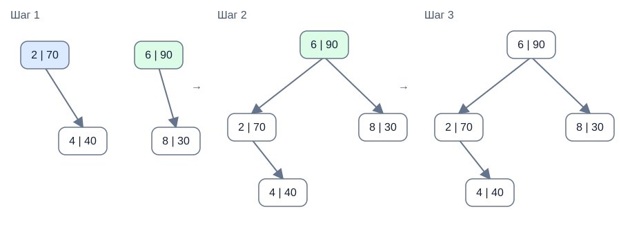

*Рисунок 43. Treap: соединить ключи 2,4 с ключами 6,8*

**Шаг 1.** Все ключи первой части меньше ключей второй — соединение допустимо. Сравниваем приоритеты двух корней: 90 больше 70.

**Шаг 2.** Корнем обязан стать 6. Его левое поддерево пусто, поэтому туда целиком помещается дерево 2,4. Правая ветвь 8 сохраняется.

**Шаг 3.** При возврате пересчитать размеры и суммы затронутых узлов. Порядок обхода 2,4,6,8 и порядок приоритетов соблюдены одновременно.

### Удаление корня через соединение его детей

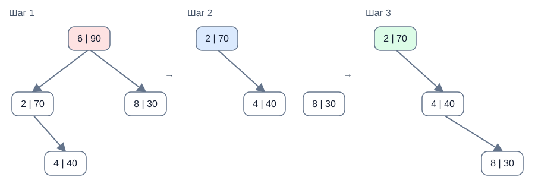

*Рисунок 44. Treap: удалить ключ 6, сравнив приоритеты корней оставшихся частей*

**Шаг 1.** Удаляемый 6 отделяем от детей. Его левое поддерево содержит 2,4, правое — 8.

**Шаг 2.** 70 больше 30: новым корнем становится 2. Его правую ветвь 4 нужно соединить с 8.

**Шаг 3.** 40 больше 30: 8 становится правым ребёнком 4. Итоговый обход 2,4,8. Прежний корень 6 больше не входит в дерево.

### Поиск ключа и ближайших соседей

*Рисунок 45. Treap: поиск 15 идёт по сравнениям, баланс не меняется*

**Как читать путь поиска**

1. Сравнить 15 с корнем 20: перейти влево.

2. Сравнить 15 с 10: перейти вправо.

3. Встретить равный ключ 15: найден. Пустая ссылка вместо него означала бы отсутствие. Ни поворот, ни перекраска для поиска не нужны.

*Рисунок 46. Treap: предшественник и преемник ключа 20*

Предшественник — максимальный ключ слева: идём влево, затем до упора вправо. Преемник — минимальный справа: идём вправо, затем до упора влево. Если нужного поддерева нет, ответ ищется среди предков: для преемника это ближайший предок, к которому путь пришёл слева; для предшественника — справа. При отсутствии такого предка соседа нет. В дереве без родительских ссылок кандидата можно запоминать при спуске от корня.

### Вычисление ранга и выбор по номеру

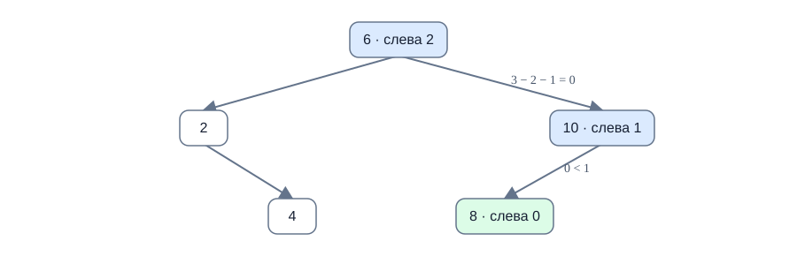

*Рисунок 47. Treap: k-й элемент с номером 3 среди 2,4,6,8,10*

Номер с нуля. В корне 6 слева два элемента, поэтому сам он имеет номер 2. Искомый номер 3 лежит справа: в правом поддереве он становится номером 0. У 10 слева один элемент, поэтому идём влево и находим 8. Значение ответа — 8, а не номер 3.

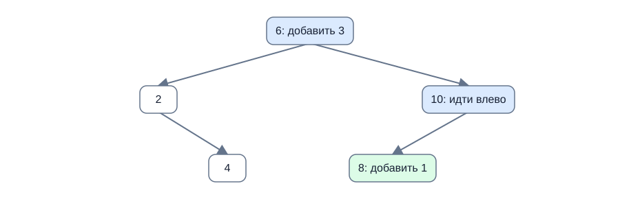

*Рисунок 48. Treap: ранг 9 равен числу ключей меньше 9*

В 6 весь левый набор 2,4 и сам ключ 6 меньше 9: сразу учитываем три элемента. В 10 ничего не добавляем, так как 10≥9, и идём влево. В 8 учитываем ещё один элемент. Итоговый ранг 9 равен 4. Сам ключ 9 может отсутствовать: для ранга это не мешает.

### Линейное построение без повторных вставок

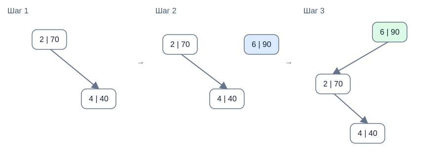

*Рисунок 49. Treap: монотонный стек при приоритетах 70,40,90*

**Шаг 1.** Отсортированные ключи 2 и 4 уже обработаны. Стек содержит правую цепочку: приоритеты 70,40 убывают.

**Шаг 2.** Приходит 6 с приоритетом 90. Извлекаем из стека 4, затем 2. Последний извлечённый корень 2 сохраняет своего ребёнка 4.

**Шаг 3.** Прежнее дерево 2,4 становится левым поддеревом 6. Каждый узел входит в стек один раз и выходит не более одного раза. Поэтому построение линейное.

## 7. Неявное декартово дерево

**Главная идея неявного treap:** дерево хранит порядок последовательности, а позиция вычисляется через размеры поддеревьев. Разрезав последовательность по двум границам, можно работать с целым диапазоном как с одним деревом.

#### Операции и схемы процесса

- **Разрез по позиции** — [рисунок 52](#figure-52)

- **Вставка** — [рисунок 54](#figure-54)

- **Выделение и удаление диапазона** — [рисунок 55](#figure-55)

- **Сумма диапазона** — [рисунок 56](#figure-56)

- **Перенос диапазона** — [рисунок 57](#figure-57)

- **Разворот диапазона** — [рисунок 51](#figure-51)

- **Передача reverse детям** — [рисунок 53](#figure-53)

- **Прибавление диапазону** — [рисунок 58](#figure-58)

- **Поиск по позиции** — [рисунок 59](#figure-59)

Здесь нет ключа, по которому сортируются значения. Inorder — сама последовательность. Значения [40,10,70] остаются именно в таком порядке. Позиция элемента вычисляется через размеры левых поддеревьев и меняется при вставках автоматически: не нужно перенумеровывать все последующие узлы.

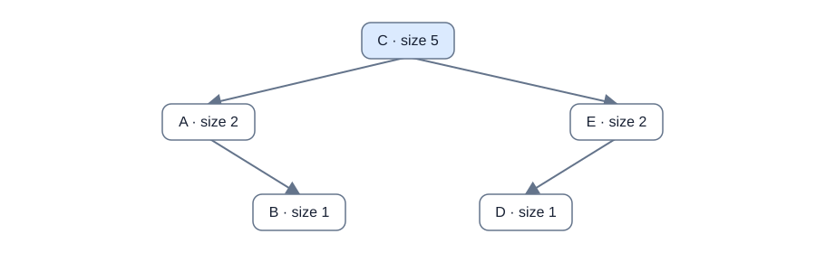

*Рисунок 50. Одна форма дерева представляет последовательность A B C D E*

### Split по количеству

splitPos(T,k) отделяет первые k элементов: допустимо 0≤k≤size(T). После push вычисли L=size(t.left). Если k≤L, граница в левом поддереве; если k>L — в правом после L+1 первых элементов.

merge остаётся таким же по приоритетам, но теперь предусловие смысловое: все элементы A должны идти раньше элементов B. Перед рекурсивным спуском выполняй push у выбранного корня. При ленивом развороте без этого можно присоединить части не к той логической стороне.

### Операции как два разреза

| Операция | Разрезы и сборка |
| --- | --- |
| Вставить X перед позицией p | Разрезать перед позицией p; вставить X между частями; соединить слева направо. |
| Выделить [l,r) | Отделить первые l элементов; от остатка отделить следующие r − l. Средняя часть и есть нужный диапазон. |
| Удалить [l,r) | Выделить среднюю часть; соединить префикс с суффиксом; отдельно освободить удалённые узлы. |
| Сумма [l,r) | Выделить среднюю часть; прочитать её сумму; собрать все части в прежнем порядке. |
| Перенести [l,r) в позицию p оставшейся последовательности | Вырезать диапазон; соединить остаток; найти позицию p в остатке и вставить туда вырезанную часть. |
| Развернуть [l,r) | Выделить диапазон; отметить его разворот; собрать последовательность обратно. |

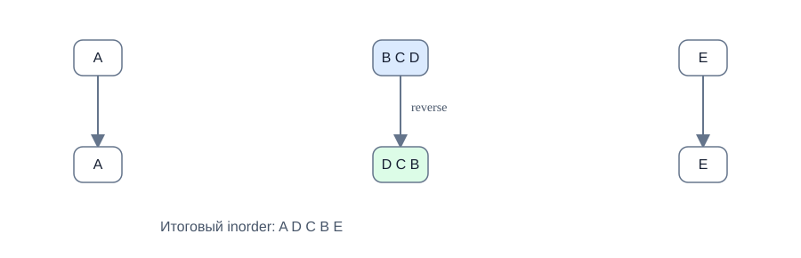

*Рисунок 51. Разворот [1,4): сначала выделить B C D, затем изменить его порядок*

### Ленивый reverse без обхода всех элементов

При принятой здесь реализации applyReverse(v) сразу меняет местами left и right у v и переключает rev. Флаг означает: детям ещё нужно передать разворот. push(v) вызывает applyReverse у обоих детей и очищает rev у v. Не меняй детей у v второй раз в push. Два разворота подряд взаимно уничтожаются, поэтому флаги соединяются XOR.

Сумма и размер при reverse не меняются. Для некоммутативного агрегата, например хеша строки, храни прямое и обратное значения и меняй их местами. Для прибавления d ко всему поддереву: value+=d, sum+=d*size, add+=d. Для суммирования reverse и add совместимы; произвольные ленивые операции нельзя считать перестановочными без доказательства.

**Как найти позицию 3 в исходном A B C D E**

1. У C слева два элемента. Позиция C равна 2.

2. 3>2: идём вправо с локальной позицией 3−2−1=0.

3. У E слева один элемент. 0<1: идём влево и получаем D. На каждом посещении сначала push.

> Каждая операция с постоянным числом split/merge ожидаемо O(log n), но освобождение m удалённых объектов требует O(m). Пустой диапазон обрабатывай как отсутствие изменений. Не путай позицию вставки, которая допускает size(T), с индексом существующего элемента, который строго меньше size(T).

#### Почему нельзя отсортировать узлы неявного treap по value?

Потому что структура хранит порядок последовательности. Величина значения не определяет позицию. Сортировка разрушит представляемую последовательность.

### Позиционный разрез на конкретном дереве

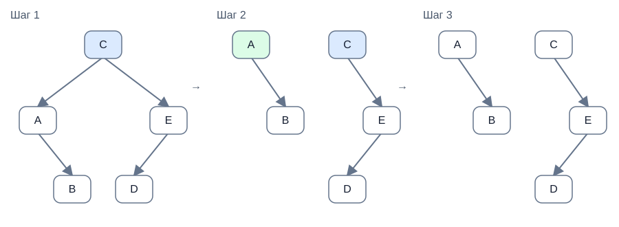

*Рисунок 52. Неявный treap: отделить первые два элемента A B*

**Шаг 1.** У C слева ровно два элемента. Граница проходит между левым поддеревом и самим C.

**Шаг 2.** Вся ветвь A,B отделяется. У C левый ребёнок становится пустым; правая часть C,D,E сохраняется.

**Шаг 3.** Получили две последовательности: A,B и C,D,E. Их размеры равны 2 и 3. Значения элементов не сравнивались.

### Как обещание разворота доходит до детей

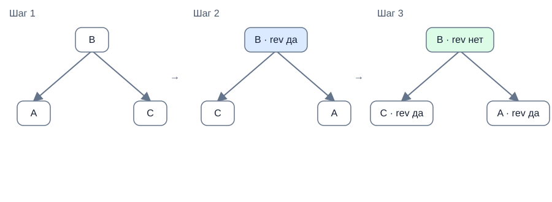

*Рисунок 53. Неявный treap: разворот A B C сначала меняет верхние связи*

**Шаг 1.** До операции обход даёт A,B,C.

**Шаг 2.** Принимая разворот, корень сразу меняет детей местами. Его флаг означает, что каждому ребёнку ещё нужно передать такое же действие.

**Шаг 3.** При спуске передать разворот обоим детям и очистить флаг корня. Корень повторно детей не меняет. Для листьев это не меняет связей, для больших поддеревьев разворот продолжится по мере обращений.

### Вставка и удаление через границы последовательности

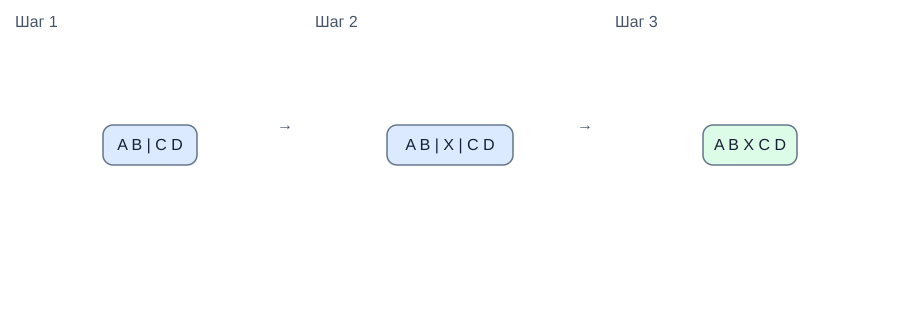

*Рисунок 54. Неявный treap: вставить X перед позицией 2*

**Шаг 1.** Разрезать после первых двух элементов. Получаем A,B и C,D.

**Шаг 2.** Поместить отдельный узел X между частями. Его значение не сравнивается с соседями.

**Шаг 3.** Соединить части слева направо. Новые позиции C,D вычислятся через размеры поддеревьев.

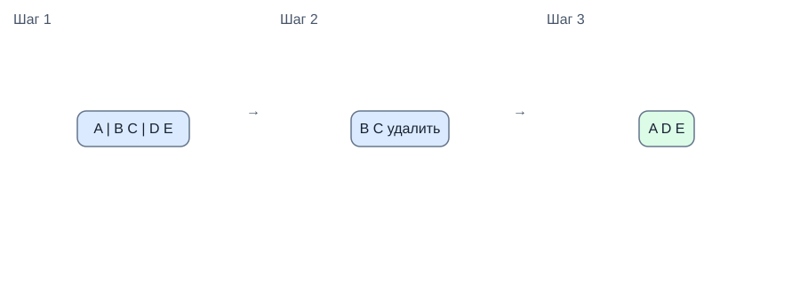

*Рисунок 55. Неявный treap: выделить и удалить диапазон [1,3)*

**Шаг 1.** Двумя разрезами выделить B,C между префиксом A и суффиксом D,E.

**Шаг 2.** Среднюю часть отделить целиком. Её узлы больше не должны входить в итоговое дерево.

**Шаг 3.** Соединить A с D,E. Если память освобождается сразу, обойти удалённую часть отдельно.

### Сумма и перенос выделенного диапазона

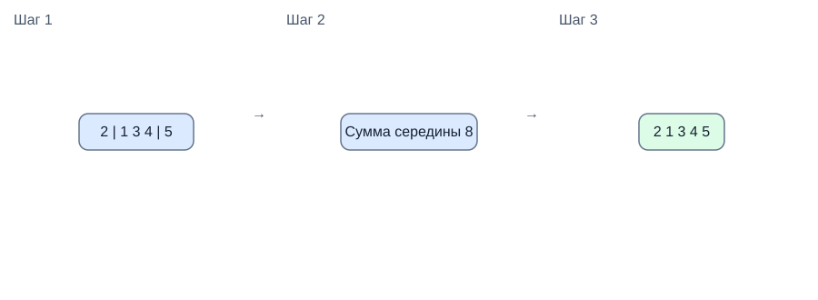

*Рисунок 56. Неявный treap: сумма диапазона [1,4)*

**Шаг 1.** Отделить среднюю часть 1,3,4 двумя разрезами.

**Шаг 2.** Взять её сохранённую сумму 8; обходить все элементы середины не требуется.

**Шаг 3.** Собрать все части в прежнем порядке. Запрос не меняет последовательность, хотя форма дерева временно могла меняться.

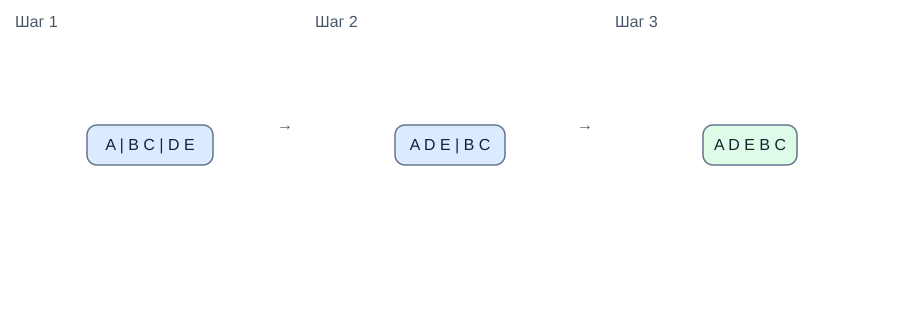

*Рисунок 57. Неявный treap: перенос B C в конец*

**Шаг 1.** Выделить диапазон [1,3), то есть B,C.

**Шаг 2.** Соединить остаток A,D,E. Позиция вставки 3 относится уже к этому остатку, поэтому означает конец.

**Шаг 3.** Вставить отделённую середину после трёх элементов остатка. Относительный порядок B,C сохраняется.

### Прибавление и чтение по позиции

*Рисунок 58. Неявный treap: прибавить 5 на [1,3)*

**Шаг 1.** Выделить второй и третий элементы, не меняя порядок остальных.

**Шаг 2.** Обновить сумму и значение корня середины; записать ленивое прибавление детям. Механика обещания показана в разделе treap.

**Шаг 3.** Собрать последовательность. При чтении по позиции сначала передавать обещания всех узлов посещаемого пути.

*Рисунок 59. Неявный treap: найти позицию 3 в A B C D E*

В C вычитаем размер левой части и сам корень: локальный номер становится 0. У E слева один элемент: нужный номер 0 находится там. Ответ — D. На каждом шаге перед просмотром детей раскрываются отложенные действия.

## 8. Дерево отрезков

**Главная идея дерева отрезков:** заранее сохранить ответы для иерархии блоков массива. Запрос выбирает несколько подходящих блоков; обновление исправляет только затронутые пути или оставляет отложенное действие целому блоку.

#### Операции и схемы процесса

- **Построение** — [рисунок 64](#figure-64)

- **Запрос суммы** — [рисунок 62](#figure-62)

- **Точечное присваивание** — [рисунок 65](#figure-65)

- **Прибавление диапазону** — [рисунок 61](#figure-61)

- **Передача lazy детям** — [рисунок 63](#figure-63)

- **Присваивание диапазону** — [рисунок 66](#figure-66)

- **Композиция set и add** — [рисунок 67](#figure-67)

Массив остаётся на фиксированных позициях. Каждый узел отвечает за полуинтервал [L,R), дети делят его около M=(L+R)/2. Значение узла — свёртка этого интервала. Например, сумма хранится заранее, чтобы при запросе целого интервала не посещать листья.

![60. Массив \[2,1,3,4,5,0,2,6\]: в узлах интервал и сумма](svg/60.svg)

*Рисунок 60. Массив [2,1,3,4,5,0,2,6]: в узлах интервал и сумма*

### Три случая запроса

Для узла [L,R) и запроса [l,r): нет пересечения — верни нейтральный элемент; узел полностью внутри — верни его агрегат; частичное пересечение — запроси обоих детей и объедини ответы в порядке слева направо. Именно полное покрытие позволяет остановиться высоко в дереве.

**Присвоить a[3]=10 вместо 4**

1. Спуск: [0,8) → [0,4) → [2,4) → [3,4).

2. В листе записать 10.

3. Возврат: [2,4) становится 3+10=13; [0,4) становится 3+13=16; корень становится 16+13=29.

4. Остальные ветви вообще не изменяются. Для суммы [2,6) новый ответ 13+5=18.

### Почему O(log n), хотя рекурсивных вызовов два

На каждом уровне не больше двух частично покрытых узлов: около левой и правой границ запроса. Полностью покрытые узлы заканчивают спуск. Поэтому суммарно посещается O(log n) узлов, а не всё дерево. Построение O(n), память O(n), точечное изменение O(log n). В рекурсивном массивном варианте обычно выделяют 4n ячеек при n>0.

### Ленивое прибавление диапазону

**При полном покрытии** увеличь сумму узла на d × (R − L) и сохрани прибавление d как отложенное действие. На этом спуск заканчивается: сумма уже верна для всего блока, хотя дети пока могут хранить старые значения.

**При частичном покрытии** сначала передай накопленное действие детям с учётом длины каждого блока. Затем измени нужные части и заново сложи суммы детей. Порядок важен: передача действия вниз предшествует пересчёту вверх.

*Рисунок 61. Прибавить 3 на [2,6): обновить два блока, листья пока не трогать*

### Присваивание и композиция действий

Для операции «всем присвоить x» нужен отдельный флаг hasSet: нулевое присваивание тоже операция. Новое set(x) уничтожает прежние set и add. Новое add(d) после set увеличивает сохранённое значение присваивания или хранится отдельным add. Передавай детям сначала set, затем add. Ошибка в порядке изменит смысл: set(5), add(2) даёт 7, а add(2), set(5) даёт 5.

Универсальный взгляд: действие f(x)=a*x+b. Сумма длины len меняется на a*sum+b*len. Если старое отложенное действие g, а новое f, хранить нужно f∘g: a_new=a_f*a_g, b_new=a_f*b_g+b_f. Прибавление — (1,d), присваивание — (0,x). Типы должны выдерживать произведения; при модульной арифметике сокращай по модулю.

> Не всякий агрегат совместим со всяким lazy. Из одного gcd интервала нельзя узнать новый gcd после прибавления ко всем элементам. Обоснуй формулу apply прежде, чем добавлять флаг. Для n=0 выдели отдельную обработку, чтобы рекурсия построения не зациклилась.

#### Почему после полного покрытия нельзя сразу пересчитать sum[v] из детей?

Дети ещё не получили ленивое обновление и содержат старые суммы. Такой pull затрёт верное значение родителя. Сначала нужно передать долг детям либо оставить агрегат родителя как есть.

### Запрос по границам и остановка на целом блоке

*Рисунок 62. Дерево отрезков: сумма [1,4) для массива 2,1,3,4*

**Шаг 1.** Корень пересекает запрос частично. Нельзя взять его сумму 10 целиком, потому что позиция 0 не нужна.

**Шаг 2.** Правый блок [2,4) входит целиком: взять 7 и не спускаться в его листья. Левый блок разделить: позицию 0 пропустить, позицию 1 взять.

**Шаг 3.** Объединить только выбранные суммы: 1+7=8. Зелёные блоки не пересекаются и точно покрывают запрос.

### Материализация отложенного прибавления

*Рисунок 63. Дерево отрезков: прибавить 3 к двум элементам, затем открыть блок*

**Шаг 1.** Сумма двух элементов равна 7. Отложенного действия нет.

**Шаг 2.** Полное покрытие позволяет изменить только корень: сумма растёт на 3×2=6. Листья ещё старые, но логически прибавление уже произошло.

**Шаг 3.** Перед обращением к части блока передать +3 детям. Они становятся 6 и 7. Сумма корня остаётся 13: повторно прибавлять к ней ничего не нужно.

### Построение и точечное присваивание

*Рисунок 64. Дерево отрезков: суммы строятся от листьев к корню*

**Шаг 1.** Каждый лист получает одно исходное значение.

**Шаг 2.** Каждый родитель объединяет два соседних блока: 2+1=3 и 3+4=7.

**Шаг 3.** Корень объединяет суммы 3 и 7. Каждый узел вычисляется один раз, поэтому построение O(n).

*Рисунок 65. Дерево отрезков: присвоить последнему элементу 10 вместо 4*

**Шаг 1.** Спуск затрагивает только путь к позиции 3. Левая половина массива остаётся целой.

**Шаг 2.** В лист записать 10. Суммы предков на промежуточной схеме ещё старые.

**Шаг 3.** Обратный пересчёт: правая сумма 3+10=13, сумма корня 3+13=16.

### Присваивание всему диапазону и порядок действий

*Рисунок 66. Дерево отрезков: присвоить 4 всем трём элементам блока*

**Шаг 1.** Исходные значения дают сумму 18.

**Шаг 2.** По полному покрытию записать сумму 4×3=12 и обещание присваивания 4. Старые обещания прибавлений этого блока поглощаются новым присваиванием.

**Шаг 3.** При раскрытии блока оба ребёнка получают присваивание с учётом своей длины. Старые значения 2,7,9 больше не участвуют в результате.

*Рисунок 67. Композиция действий: сначала присвоить 4, затем прибавить 3*

**Шаг 1.** Начальные значения не влияют на результат после присваивания.

**Шаг 2.** Присваивание заменяет предысторию каждого элемента на 4.

**Шаг 3.** Следующее прибавление меняет 4 на 7. В обратном порядке результат был бы 4: порядок обещаний сохраняется.

## 9. Дерево Фенвика

**Главная идея Фенвика:** префикс раскладывается на несколько двоичных блоков. Запрос последовательно убирает последний блок префикса; изменение точки поднимается по всем сохранённым блокам, которые её содержат.

#### Операции и схемы процесса

- **Сумма префикса** — [рисунок 68](#figure-68)

- **Точечное прибавление** — [рисунок 69](#figure-69)

- **Сумма диапазона** — [рисунок 71](#figure-71)

- **Точечное присваивание** — [рисунок 72](#figure-72)

- **Линейное построение** — [рисунок 73](#figure-73)

- **Поиск k-го по частотам** — [рисунок 74](#figure-74)

- **Прибавление диапазону через разности** — [рисунок 75](#figure-75)

- **Сумма после диапазонных прибавлений** — [рисунок 76](#figure-76)

Фенвик хранит суммы специальных блоков в одном массиве. Внутренние индексы 1…n. lowbit(i)=i & -i — вес младшего установленного бита. Ячейка bit[i] хранит закрытый блок [i−lowbit(i)+1,i]. В отличие от дерева отрезков, здесь сохранены только некоторые интервалы.

| i | Двоично | lowbit | Блок | Сумма для [2,1,3,4,5,0,2,6] |
| --- | --- | --- | --- | --- |
| 1 | 0001 | 1 | [1,1] | 2 |
| 2 | 0010 | 2 | [1,2] | 3 |
| 3 | 0011 | 1 | [3,3] | 3 |
| 4 | 0100 | 4 | [1,4] | 10 |
| 5 | 0101 | 1 | [5,5] | 5 |
| 6 | 0110 | 2 | [5,6] | 5 |
| 7 | 0111 | 1 | [7,7] | 2 |
| 8 | 1000 | 8 | [1,8] | 23 |

*Рисунок 68. Префикс 7 разбивается на непересекающиеся блоки*

### Запрос префикса

Чтобы суммировать первые i элементов, возьми bit[i] и перейди к i−lowbit(i). Блок заканчивается в i; новый индекс расположен ровно перед его началом. Так блоки не пересекаются и покрывают весь префикс. Число шагов равно числу единичных битов i, значит O(log n).

### Обновление точки

Чтобы прибавить d к элементу i, обновляй bit[i], затем i+=lowbit(i), пока индекс ≤n. Мы идём к следующему сохранённому блоку, включающему эту точку. Например, для позиции 5 путь 5→6→8. Изменение позиции 3 затрагивает 3→4→8. Для присваивания сначала найди старое значение и передай разность.

*Рисунок 69. Прибавить 4 к позиции 5: обновляются все содержащие её блоки*

### Линейное построение и границы применимости

За O(n) можно пройти i=1…n: сначала bit[i]+=a[i−1], затем j=i+lowbit(i), и если j≤n, выполнить bit[j]+=bit[i]. К моменту передачи bit[i] уже содержит свой полный блок. Память O(n).

Получение суммы диапазона через разность префиксов использует обратимость сложения. Для минимума вычитания нет. Существуют ограниченные варианты Fenwick для префиксных минимумов с только уменьшающими обновлениями, но они не заменяют произвольные range-min query и присваивания.

### Поиск k-го по частотам

Если a[i]≥0, префиксы не убывают. Чтобы найти первый префикс с суммой ≥k, можно идти по степеням двойки: pos=0, accumulated=0; пробовать next=pos+step, начиная с наибольшей степени двойки ≤n. Если next≤n и accumulated+bit[next]<k, принять переход, затем step/=2. По окончании внутренний индекс ответа pos+1, внешний индекс pos. Требуется 1≤k≤общая сумма. Это O(log n), в отличие от двоичного поиска с отдельными prefix за O(log² n).

### Прибавление диапазону через разности

Пусть D[i]=A[i]−A[i−1], A[0]=0 при внутренних индексах. Прибавление d на [l,r] даёт D[l]+=d и D[r+1]−=d, если r+1≤n. Один Fenwick по D позволяет получать A[i] как префикс. Для сумм массива нужны два: B1 хранит D[j], B2 хранит (j−1)*D[j]. Тогда сумма A[1…i] равна i*prefix(B1,i)−prefix(B2,i). Это следует из того, что D[j] входит в i−j+1 элементов префикса.

#### Почему нельзя вызвать внутренний add(0,d) в цикле i+=lowbit(i)?

lowbit(0)=0, индекс никогда не сдвинется. Внешняя позиция 0 корректна, если перед обходом преобразовать её во внутреннюю 1.

### Как исчезают последние блоки префикса

*Рисунок 70. Фенвик: префикс длины 7 уменьшается при каждом шаге*

**Шаг 1.** Блок ячейки 7 содержит только последний элемент. После его учёта остаётся префикс длины 6.

**Шаг 2.** Блок ячейки 6 содержит элементы 5 и 6. После его учёта остаётся префикс длины 4.

**Шаг 3.** Блок ячейки 4 покрывает все оставшиеся элементы. Остаток пуст, запрос завершён. Внутренние индексы здесь с единицы.

### Разность префиксов и присваивание точки

*Рисунок 71. Фенвик: сумма диапазона как разность двух префиксов*

**Шаг 1.** Для массива 2,1,3,4,5 правый префикс включает нужный диапазон и лишние первые два элемента.

**Шаг 2.** Левый префикс состоит ровно из лишних элементов 2,1.

**Шаг 3.** Вычесть 3 из 15. Лишний префикс удалён, остаётся 3+4+5=12.

*Рисунок 72. Фенвик: присвоить элементу 9 вместо 5*

**Шаг 1.** Получить старое значение как сумму диапазона длины один либо из отдельного исходного массива.

**Шаг 2.** Вычислить разность нового и старого значений: 9−5=4.

**Шаг 3.** Выполнить обычное точечное прибавление +4 ко всем содержащим позицию блокам. Присваивать 9 непосредственно этим блокам нельзя.

### Построение и поиск по накопленной частоте

*Рисунок 73. Фенвик: линейное построение переносит готовый блок вверх*

**Шаг 1.** Проход идёт по внутренним индексам слева направо. Добавить первый элемент 2 к ячейке 1 и передать её накопленную сумму в ячейку 2.

**Шаг 2.** В ячейке 2 уже лежит 2 от предыдущего блока. Добавить собственный элемент 1, получив готовую сумму 3.

**Шаг 3.** Передать сумму 3 следующему охватывающему блоку, ячейке 4. Аналогично обработать остальные индексы. Каждый индекс делает не более одной передачи.

*Рисунок 74. Фенвик: найти первый префикс с суммой не меньше 5*

**Шаг 1.** Все частоты неотрицательны. Ищем позицию пятой единицы накопленной частоты.

**Шаг 2.** При двоичном подъёме можно принять переход к длине 2: её сумма ещё меньше цели. Переход к длине 4 с суммой 10 принимать нельзя.

**Шаг 3.** Следующая проба длины 3 уже достигает цели, поэтому она остаётся за границей принятых переходов. Ответ: внутренний индекс 3, внешний индекс 2.

### Прибавление отрезку через изменения на границах

![75. Фенвик: прибавление +3 на внутренних позициях \[2,4\]](svg/75.svg)

*Рисунок 75. Фенвик: прибавление +3 на внутренних позициях [2,4]*

**Шаг 1.** Нужно прибавить 3 только ко второму, третьему и четвёртому элементам. Здесь границы закрытые и индексы с единицы.

**Шаг 2.** В массиве разностей добавить +3 в начале и −3 сразу после конца. Если позиции 5 нет, второе изменение за массивом можно не хранить.

**Шаг 3.** Префикс разностей даёт добавку: перед позицией 2 она 0, внутри диапазона 3, после позиции 4 снова 0. Один Fenwick хранит эти разности.

*Рисунок 76. Два Fenwick: сумма префикса после диапазонных прибавлений*

**Шаг 1.** Одна разность на позиции j прибавляется ко всем элементам начиная с j.

**Шаг 2.** В префиксе длины i она встречается i−j+1 раз. Все такие вклады нужно сложить.

**Шаг 3.** Первая структура хранит суммы D[j], вторая — суммы (j−1)×D[j]. Поэтому ответ равен i×S1−S2. Сумма диапазона снова получается вычитанием двух префиксных ответов.

## 10. Trie и compact trie

**Главная идея trie:** общие начала строк используют общий путь. В обычном trie каждое ребро хранит один символ, в сжатом — целый фрагмент. Признак конца слова отличает самостоятельное слово от простого префикса.

#### Операции и схемы процесса

- **Точный поиск слова** — [рисунок 81](#figure-81)

- **Поиск и перечисление по префиксу** — [рисунок 81](#figure-81)

- **Вставка в обычное trie** — [рисунок 82](#figure-82)

- **Удаление из обычного trie** — [рисунок 80](#figure-80)

- **Сжатие цепочки** — [рисунок 83](#figure-83)

- **Поиск в compact trie** — [рисунок 84](#figure-84)

- **Вставка с расщеплением ребра** — [рисунок 79](#figure-79)

- **Вставка слова внутри ребра** — [рисунок 86](#figure-86)

- **Удаление и склейка рёбер** — [рисунок 85](#figure-85)

Trie хранит не сравнения целых строк, а их общий путь по символам. Корень соответствует пустой строке, ребро — следующему символу, узел — префиксу. Слово существует, только если в конечном узле стоит terminal. Сам факт наличия пути означает лишь наличие такого префикса.

*Рисунок 77. Trie для to, tea, ten: terminal помечен звёздочкой*

### Поиск, вставка и удаление

**Вставка team в существующее trie**

1. Пройти t→e→a: все эти рёбра уже есть.

2. Создать только ребро m и новый terminal team. Маркер tea остаётся: слово может быть префиксом другого.

3. Если ведутся счётчики, увеличить число слов в поддереве на всём пути. Для множества повторная вставка уже имеющегося слова не должна менять счётчики.

Поиск слова s проходит все символы и проверяет terminal. Поиск префикса не требует terminal. Удаление сначала подтверждает наличие слова, затем снимает terminal; снизу удаляет лишь узлы, у которых нет детей и нет terminal. При наличии счётчиков обнови их на всём пути. Удаление tea не должно удалить путь team.

При O(1) доступе к ребёнку поиск и вставка строки длины m занимают O(m), а не O(log числа слов). Массив из |Σ| ссылок быстр, но память O(V|Σ|). Словарь детей экономнее при разреженном алфавите: balanced map добавляет log степени, hash map даёт ожидаемый O(1) на переход. Байты UTF-8 и символы Unicode — разные единицы: заранее реши, что является символом ключа.

### Сжатие цепочек

Compact trie заменяет цепочку узлов без ветвления одним ребром с подстрокой. Но terminal внутри цепочки терять нельзя. Обычно terminal-узлы сохраняют даже при одном ребёнке. Корень — исключение из правил удаления. Метки рёбер удобно хранить как диапазоны в стабильном хранилище строк, чтобы не копировать длинные подстроки.

*Рисунок 78. Compact trie для to, tea, ten: точки ветвления сохраняются*

У слов to, tea, ten точки ветвления t и te сохраняются, поэтому сжатие почти незаметно. Более показателен набор car, cart: от корня идёт ребро car к узлу конца слова, затем ребро t к концу cart.

Промежуточные узлы c и ca исчезают. Узел car остаётся, хотя у него один ребёнок: он хранит самостоятельное слово, и терять эту границу нельзя.

*Рисунок 79. Вставка cat расщепляет ребро car после общей части ca*

**Все случаи вставки в compact trie**

1. Нет ребра с нужным первым символом: создать ребро с оставшимся суффиксом и terminal-лист.

2. Метка ребра полностью совпала: перейти в ребёнка и продолжить.

3. Совпала только часть метки: создать промежуточный узел на длине LCP, старое ребро сократить до хвоста, новый хвост добавить вторым ребёнком.

4. Если слово закончилось внутри метки, расщепить ребро и сделать промежуточный узел terminal. Если закончилось ровно в узле, поставить terminal там.

При точном поиске сравнивай всю метку, а не только её первый символ. При запросе префикса допустимо завершить запрос посреди ребра: весь лежащий ниже набор слов подходит. После удаления, если неterminal-узел имеет единственного ребёнка, склей входящую и исходящую метки. При стабильных ссылках на подстроки склейка может потребовать нового представления метки или копирования: стоимость этого нельзя игнорировать.

При постоянной цене выбора ребра суммарно сравнивается O(m) символов запроса. Число структурных узлов сжатого trie — O(N) для N различных слов, но сами строки и метки требуют места пропорционально хранимым данным. Выдача всех слов по префиксу дополнительно стоит объёма результата.

#### Что произойдёт при вставке ca в дерево с единственным ребром car?

Ребро разделится на ca и r. Узел ca станет terminal, старый terminal car останется внизу. Нельзя просто поставить terminal на car: это другое слово.

### Почему удаление префикса не удаляет длинное слово

*Рисунок 80. Trie: удалить слово a, сохранив ab*

**Шаг 1.** Звёздочка означает конец слова. Оба слова используют общий путь через a.

**Шаг 2.** Снять только признак конца у a. У него остаётся ребёнок b, поэтому сам узел удалять нельзя.

**Шаг 3.** Поиск a теперь даёт отсутствие, поиск ab — наличие. В обычном trie цепочка остаётся; в сжатом её можно заменить ребром ab.

### Отдельно путь, конец слова и префикс

*Рисунок 81. Trie: поиск te и tea проходит одинаковое начало*

Точный поиск te заканчивается в узле без звёздочки: такого слова нет. Поиск префикса te успешен, потому что путь существует. Для слова tea нужно пройти ещё символ a и встретить признак конца слова. Для перечисления всех слов с префиксом te обойти ниже обе ветви: tea и ten.

*Рисунок 82. Trie: вставка team добавляет только недостающий суффикс*

**Шаг 1.** Путь t,e,a уже существует и слово tea уже отмечено.

**Шаг 2.** Добавить недостающее ребро m и новый узел. Старый terminal tea сохраняется.

**Шаг 3.** Отметить новый узел как конец слова team. Предыдущие общие рёбра не дублируются.

### Сжатие, поиск и удаление в compact trie

*Рисунок 83. Compact trie: сжатие пути c → a → r*

**Шаг 1.** Промежуточные узлы c и ca не заканчивают слов и имеют по одному ребёнку.

**Шаг 2.** Они не принимают решений поиска и не сохраняют самостоятельных слов, поэтому их можно убрать.

**Шаг 3.** Объединить метки в car. Последний terminal-узел остаётся. Корень также сохраняется.

*Рисунок 84. Compact trie: сравнение cat с меткой car*

**Шаг 1.** Выбрать ребро по первому символу c.

**Шаг 2.** Сравнивать всю метку ребра. Первые два символа равны, третий различается.

**Шаг 3.** Не переходить к листу car и не выдавать ложное совпадение. Если запрос префикса равен ca, он, напротив, успешно заканчивается внутри ребра car.

*Рисунок 85. Compact trie: удалить car и склеить оставшийся путь cart*

**Шаг 1.** Слово car является префиксом cart. Удалять всю его ветвь нельзя.

**Шаг 2.** Снять признак конца car. Теперь внутренний узел имеет ровно одного ребёнка и не хранит слова.

**Шаг 3.** Склеить метки car и t в cart. Длинное слово сохранено, лишняя точка перехода исчезла.

### Вставка слова, заканчивающегося внутри сжатого ребра

*Рисунок 86. Compact trie: вставить ca в дерево со словом car*

**Шаг 1.** Слово ca совпадает с началом ребра car и заканчивается раньше его метки.

**Шаг 2.** Расщепить метку после ca. Старое слово car остаётся ниже ребра r.

**Шаг 3.** Отметить промежуточный узел ca как конец нового слова. Теперь в дереве два слова, хотя развилки по разным символам не появилось.

## 11. PATRICIA как сжатое двоичное trie

**Главная идея PATRICIA:** хранить только те биты, на которых ключи действительно расходятся. Пропуск остальных уровней экономит узлы, но требует полного сравнения ключа в найденном листе.

#### Операции и схемы процесса

- **Точный поиск с проверкой листа** — [рисунок 90](#figure-90)

- **Вставка новой развилки** — [рисунок 88](#figure-88)

- **Удаление листа и лишней развилки** — [рисунок 89](#figure-89)

PATRICIA — семейство близких представлений сжатого двоичного trie. Здесь рассматривается вариант с отдельными внутренними узлами и листьями для ключей фиксированной длины w бит.

Внутренний узел хранит номер различающего бита, лист — полный ключ. Поиск пропускает уровни, на которых решения не требуется. В классическом представлении с обратными ссылками устройство обхода отличается.

Биты нумеруются от старшего: 0…w−1. На пути вниз номера проверяемых битов строго растут. Не храним уровни, на которых все ключи поддерева совпадают: они не принимают решений. При поиске всегда проверяй полное равенство в листе, потому что пропущенные биты не сравнивались.

*Рисунок 87. Ключи 0010, 0011, 1010: нужны только различающие биты 0 и 3*

**Поиск 0000, которого нет**

1. bit 0 равен 0 → идём влево.

2. bit 3 равен 0 → попадаем в лист 0010.

3. Полное сравнение 0000≠0010: отсутствует. Если сравнивать только проверенные биты, получится ложное совпадение.

### Вставка через первый различающий бит

**Вставить 0110 в показанное дерево**

1. Обычным поиском дойти до листа 0010.

2. Первый различающий бит 0110 и 0010 имеет номер 1.

3. Повторно пройти путь от корня, пока номер следующего внутреннего бита меньше 1: корень bit 0 проходим, перед bit 3 останавливаемся.

4. Вставить узел bit 1 над старым bit 3. Его ребёнок 0 — прежнее поддерево, ребёнок 1 — новый лист 0110. Связь от bit 0 направить на bit 1.

*Рисунок 88. После вставки 0110: новый уровень лишь там, где появилась развилка*

### Удаление и стоимость

Найди лист и проверь ключ. Запомни его родителя p и ссылку от дедушки. Удали лист и p, а брата листа подставь на место p. Если лист единственный, root становится пустым. Корень — родитель удалённого листа? Тогда брат становится новым корнем. Все листья остаются на прежних различающих путях.

Внутренних узлов N−1 для N непустых уникальных ключей. Число ветвлений на пути не превышает min(w,N−1), но строгой гарантии O(log N) у произвольного набора нет. Сравнение полных ключей и нахождение первого различающего бита стоят O(w) побитно; для ключа машинного слова XOR и count-leading-zeros обычно выполняются за O(1) в принятой модели. Не вызывай инструкцию clz(0), если её контракт не допускает ноль.

> Для строк переменной длины нужно различать конец слова и продолжение: например, отдельный символ конца с корректным кодированием или длина в представлении ключа. Наивное дополнение нулями сделает некоторые разные строки неразличимыми. Для первой реализации фиксированные uint32_t/uint64_t заметно упрощают контракт.

#### Почему новый узел bit 1 нельзя просто подвесить под bit 3?

Номера битов на пути должны возрастать. Кроме того, bit 1 разделяет весь старый набор под bit 3 и новый ключ, поэтому должен находиться выше этой развилки.

### Удаление лишней развилки после удаления листа

*Рисунок 89. PATRICIA: удалить 0011 и убрать проверку бита 3*

**Шаг 1.** Лист 0011 найден и проверен полным сравнением. Его родитель различает два ключа по биту 3.

**Шаг 2.** После удаления листа у проверки бита 3 остаётся только один ребёнок. Это промежуточное состояние: такая развилка больше не нужна.

**Шаг 3.** Заменить узел бита 3 его единственным оставшимся листом 0010. Проверка бита 0 остаётся: ключи 0010 и 1010 по нему всё ещё различаются.

### Поиск обязан завершиться полным сравнением

*Рисунок 90. PATRICIA: запрос 0000 доходит до чужого листа 0010*

Проверки пропущенных битов на пути не было. Поэтому попадание в лист 0010 не означает успех: целый ключ сравнивается с 0000, и поиск возвращает отсутствие. Для запроса 0010 тот же путь закончился бы успехом.

## 12. КМП: Z-функция, sp′ и поиск подстроки

От совпадений внутри образца — к сдвигам при поиске. Основной пример — **abacaba**. Разберём не только формулы, но и то, почему после несовпадения можно сохранить часть работы.

**Маршрут по главе**

- [Префикс, суффикс и индексы](#kmp-terms)

- [Как устроена Z-функция](#kmp-z-values)

- [Линейный Z-препроцессинг](#kmp-z-window)

- [Зачем нужна sp′](#kmp-sp-prime)

- [Переход от Z к sp′](#kmp-z-to-sp)

- [Поиск и откаты](#kmp-search)

- [Пошаговый тренажёр](#kmp-interactive)

- [КМП реального времени](#kmp-realtime)

- [Проверки и ошибки](#kmp-checks)

### 1. Что ищем и как читаем индексы

Даны текст T длины n и образец P длины m. Ищем все начала вхождений P в T, включая перекрывающиеся. Для текста abacabacaba образец abacaba встречается с позиций 0 и 4. Один участок текста может принадлежать сразу двум вхождениям.

> **Все индексы здесь с нуля.** P[0:k) — первые k символов, правая граница не включается. Позиции образца abacaba: 0:a, 1:b, 2:a, 3:c, 4:a, 5:b, 6:a. Переменная q означает количество совпавших символов, поэтому следующий ожидаемый символ — P[q].

Префикс — начало строки, суффикс — её окончание. Оба читаются слева направо. Суффикс не переворачивается: последние два символа abacaba — ba, а не ab. Собственная граница — одинаковые префикс и суффикс, которые короче всей рассматриваемой строки.

| Длина | Префикс abacaba | Суффикс abacaba | Результат |
| --- | --- | --- | --- |
| 1 | a | a | Граница |
| 2 | ab | ba | Не равны; ba не переворачиваем |
| 3 | aba | aba | Самая длинная собственная граница |
| 4 | abac | caba | Не равны |
| 5 | abaca | acaba | Не равны |
| 6 | abacab | bacaba | Не равны |
| 7 | abacaba | abacaba | Вся строка: исключена определением |

*Рисунок 91. Начало aba и окончание aba совпадают без переворота*

Обычная префикс-функция π[i], которую также обозначают sp[i], хранит длину самой длинной собственной границы P[0:i+1). Для abacaba она равна [0, 0, 1, 0, 1, 2, 3]. Например, π[4] = 1 относится к строке abaca, у которой граница a. Символы справа от позиции 4 при определении этой границы не участвуют.

### 2. Z-функция: совпадения с началом образца

Z[i] — длина самого длинного фрагмента, начинающегося в позиции i и совпадающего с началом P. Сравниваем P[0] с P[i], затем P[1] с P[i+1] и так далее до первого несовпадения или конца строки. Это не поиск границы всего префикса: начальная позиция совпадения здесь фиксирована, а длина определяется сравнением.

> **Договорённость о Z[0].** В этой главе Z[0] = m, поскольку вся строка совпадает с собой. Иногда пишут Z[0] = 0. Оба соглашения подходят: построение sp′ использует только позиции от 1 до m−1.

| i | Суффикс от i | Проверка с началом abacaba | Z[i] |
| --- | --- | --- | --- |
| 0 | abacaba | Вся строка совпадает с собой | 7 |
| 1 | bacaba | b ≠ a: совпадение не началось | 0 |
| 2 | acaba | a = a, затем c ≠ b | 1 |
| 3 | caba | c ≠ a | 0 |
| 4 | aba | Совпало aba, достигнут конец строки | 3 |
| 5 | ba | b ≠ a | 0 |
| 6 | a | Совпал a, достигнут конец строки | 1 |

![92. Z\[4\] = 3: фрагмент от позиции 4 совпадает с началом](svg/92.svg)

*Рисунок 92. Z[4] = 3: фрагмент от позиции 4 совпадает с началом*

Каждый положительный Z[i] задаёт Z-блок [i, i+Z[i]). Для abacaba непустые блоки начинаются в 2, 4 и 6. Блок от 4 заканчивается на позиции 6 включительно. Запомни разницу: i+Z[i] — граница справа, а i+Z[i]−1 — индекс последнего совпавшего символа.

### 3. Как вычислить Z за O(m), а не сравнивать всё заново

Храним окно [L,R), совпадающее с началом образца и имеющее самый дальний известный конец. Инвариант: P[L:R) = P[0:R−L). Окно может быть пустым. Правая граница исключена, поэтому внутри него находятся позиции i < R.

**Обработка очередной позиции i**

1. Если i ≥ R, окно ничего не сообщает о совпадении от i. Начни с длины 0.

2. Если i < R, используй соответствующую позицию i−L в начале образца: начальная длина равна min(Z[i−L], R−i).

3. Сравни следующие символы P[Z[i]] и P[i+Z[i]]. Пока они равны и правая позиция существует, увеличивай длину.

4. Если i+Z[i] > R, новое совпадение уходит дальше: замени окно на [i, i+Z[i]).

5. Сохрани Z[i] и перейди к следующей позиции. Уже известные значения не пересчитывай.

Почему можно копировать Z[i−L]? Внутри окна строка повторяет начало P, поэтому относительное положение i−L переносит нас в уже изученный фрагмент. Но за R совпадение не доказано: поэтому копируем не больше R−i символов. Остальное проверяем явно.

| i | Окно до шага | Начальная длина | Проверки | Z[i], окно после |
| --- | --- | --- | --- | --- |
| 1 | [0,0) | 0 | b ≠ a | 0; [1,1) |
| 2 | [1,1) | 0 | a = a; c ≠ b | 1; [2,3) |
| 3 | [2,3) | 0 | c ≠ a | 0; [2,3) |
| 4 | [2,3) | 0 | a = a, b = b, a = a; конец | 3; [4,7) |
| 5 | [4,7) | min(Z[1],2) = 0 | b ≠ a | 0; [4,7) |
| 6 | [4,7) | min(Z[2],1) = 1 | Уже достигнут конец | 1; [4,7) |

Линейность получается за счёт правой границы: новые успешные сравнения за известным окном двигают R вправо, всего не более m раз. Если скопированное совпадение закончилось строго внутри окна, следующее сравнение обнаруживает известное несовпадение. Дополнительно на каждую позицию приходится не более одного неуспешного завершающего сравнения. Итого O(m) времени и O(m) памяти.

### 4. Зачем после Z вводится sp′ — «эс-пэ штрих»

Обычная граница позволяет сохранить часть совпавших символов. Но при несовпадении мы знаем ещё кое-что: текущий символ текста не равен ожидаемому символу образца. Если после отката снова ожидается ровно тот же символ, сравнение заранее обречено на неудачу. Сильная таблица sp′ пропускает такие границы.

> **Определение для i < m−1.** sp′[i] — максимальная длина k собственной границы P[0:i+1), для которой P[k] ≠ P[i+1]. Если положительной длины с этим свойством нет, значение равно 0. Для последней позиции используем sp′[m−1] = π[m−1]: после полного совпадения нужно сохранить самую длинную собственную границу.

Условие относится к символам **после** двух совпавших фрагментов. При длине границы k последний символ префикса имеет индекс k−1, а следующий — k. После суффикса, заканчивающегося в i, находится P[i+1]. Сравниваем именно P[k] и P[i+1], а не последние символы границы.

| i | Префикс до i | Обычная граница | Символы после неё | π[i] | sp′[i] |
| --- | --- | --- | --- | --- | --- |
| 0 | a | Нет непустой | — | 0 | 0 |
| 1 | ab | Нет непустой | — | 0 | 0 |
| 2 | aba | a, k = 1 | P[1] = b, P[3] = c: различаются | 1 | 1 |
| 3 | abac | Нет непустой | — | 0 | 0 |
| 4 | abaca | a, k = 1 | P[1] = b, P[5] = b: одинаковые | 1 | 0 |
| 5 | abacab | ab, k = 2 | P[2] = a, P[6] = a: одинаковые | 2 | 0 |
| 6 | abacaba | aba, k = 3 | Конец образца: сохраняем границу | 3 | 3 |

Итак, для abacaba: **sp′ = [0, 0, 1, 0, 0, 0, 3]**. Она отличается от π = [0, 0, 1, 0, 1, 2, 3]. Обозначения sp и sp′ нельзя использовать как взаимозаменяемые.

**Почему sp′[4] = 0, хотя π[4] = 1**

1. В тексте уже совпало abaca. Следующим образец ожидает b, но текущий символ текста — другой.

2. Обычный откат мог бы сохранить последнюю a как начало нового совпадения.

3. Однако после начальной a образец опять ожидает b. Мы уже знаем, что текущий символ не b: повторная проверка бесполезна.

4. Положительных подходящих границ больше нет. Сильный откат сразу переходит к состоянию 0 и проверяет тот же символ с P[0] = a.

*Рисунок 93. Граница a в abaca пропускается: после обеих a ожидается b*

Нулевое значение — договорённость «подходящей непустой границы нет». Оно не утверждает, что P[0] обязательно отличается от ожидавшегося символа. Поэтому обработка состояния 0 в поиске всё равно нужна.

### 5. Почему sp′ получается из концов Z-блоков

Пусть j > 0 и Z[j] = k > 0. Совпадение P[0:k) = P[j:j+k) заканчивается в i = j+k−1. Значит, k — длина собственной границы префикса P[0:i+1).

Если блок закончился до конца образца, то следующие символы различаются: иначе Z[j] можно было бы увеличить. Получаем P[k] ≠ P[i+1] — как раз дополнительное условие сильной границы. Если блок достиг конца образца, получаем обычную границу всего образца для продолжения после ответа.

> **Отличие от построения π.** Для sp′ записывается длина только на **конце максимального Z-блока**. Его внутренние позиции не заполняют убывающими длинами: совпадение там ещё продолжается, следовательно, следующие символы равны. Такое заполнение давало бы информацию для обычной π, а не sp′.

**Построение sp′ за линейное время**

1. Создай массив длины m, заполненный нулями.

2. Перебирай начала j от m−1 вниз до 1. Позицию 0 не используй.

3. Если Z[j] = 0, пропусти эту позицию.

4. Иначе вычисли конечный индекс i = j + Z[j] − 1 и запиши sp′[i] = Z[j].

5. Если ячейка уже заполнена, перезапиши её: при таком порядке новая длина будет больше.

Почему идём справа налево? Для фиксированного конца i длина равна i−j+1. Чем левее начало j, тем длиннее совпадение. Левое начало обрабатывается позже и оставляет максимальную длину. При проходе слева направо без максимума короткая граница могла бы затереть длинную.

| j, справа налево | Z[j] | Конец i | Изменение | Массив sp′ после шага |
| --- | --- | --- | --- | --- |
| 6 | 1 | 6 | sp′[6] = 1 | [0,0,0,0,0,0,1] |
| 5 | 0 | — | Пропуск | [0,0,0,0,0,0,1] |
| 4 | 3 | 6 | sp′[6] = 3: заменяем 1 | [0,0,0,0,0,0,3] |
| 3 | 0 | — | Пропуск | [0,0,0,0,0,0,3] |
| 2 | 1 | 2 | sp′[2] = 1 | [0,0,1,0,0,0,3] |
| 1 | 0 | — | Пропуск | [0,0,1,0,0,0,3] |

Здесь один проход и постоянное число действий на позицию, поэтому преобразование занимает O(m) времени. Образец не перечитывается попарными сравнениями; вся информация уже есть в Z. При нулевой Z-ячейке лучше сразу делать пропуск, особенно если индексы беззнаковые: не вычисляй выражение с вычитанием единицы без необходимости.

### 6. Как поиск использует sp′

Храним i — позицию следующего символа текста, и q — длину уже совпавшего префикса. Пока q < m, текст непосредственно перед i заканчивается на P[0:q). Следующая пара для сравнения — T[i] и P[q]. После сильного отката сохранённая часть тоже совпадает, хотя она не обязана быть самой длинной обычной границей: часть кандидатов намеренно пропущена.

**Действия при сравнении**

1. Если символы равны: увеличь i и q. Продолжай вправо.

2. Если q стало равно m: сообщи начало i−m. Затем замени q на sp′[m−1]. Индекс i не меняется.

3. При несовпадении и q > 0: замени q на sp′[q−1]. Символ T[i] ещё не обработан: сравни его снова, теперь с новым P[q].

4. При несовпадении и q = 0: увеличь только i. Подходящего начала на этой позиции нет.

5. Когда i достигло длины текста, новых символов нет. Полное совпадение, завершившееся на последнем символе, должно быть зарегистрировано.

Почему q−1? Если совпало q символов, последняя совпавшая позиция образца имеет индекс q−1. Таблица sp′ привязана к этой последней позиции, а не к следующему ожидаемому символу.

В терминах сдвига: при положительной длине q старое начало выравнивания равно i−q, новое — i−sp′[q−1]. Значит, образец сдвигается на q−sp′[q−1]. Индекс текста остаётся на месте. Например, при q = 3 и sp′[2] = 1 сдвиг равен 2.

### 7. Полная трассировка: abacaba в ababacaba

| i | T[i] | q до сравнения | Ожидаемый символ | Действие |
| --- | --- | --- | --- | --- |
| 0 | a | 0 | P[0] = a | Совпало: i = 1, q = 1 |
| 1 | b | 1 | P[1] = b | Совпало: i = 2, q = 2 |
| 2 | a | 2 | P[2] = a | Совпало: i = 3, q = 3 |
| 3 | b | 3 | P[3] = c | Не совпало: q = sp′[2] = 1, i остаётся 3 |
| 3 | b | 1 | P[1] = b | Тот же b подошёл: i = 4, q = 2 |
| 4 | a | 2 | P[2] = a | Совпало: i = 5, q = 3 |
| 5 | c | 3 | P[3] = c | Совпало: i = 6, q = 4 |
| 6 | a | 4 | P[4] = a | Совпало: i = 7, q = 5 |
| 7 | b | 5 | P[5] = b | Совпало: i = 8, q = 6 |
| 8 | a | 6 | P[6] = a | i = 9, q = 7: ответ 9−7 = 2; затем q = 3 |

*Рисунок 94. После несовпадения c с b сохраняем последнюю a*

### 8. Где сильная таблица пропускает лишнее сравнение

Пусть P = abacaba, T = abacac. Первые пять символов abaca совпали. На позиции текста 5 находится c, а образец ожидает b, поэтому возникает несовпадение при q = 5.

| Таблица | Последовательность действий с текущим c | Почему |
| --- | --- | --- |
| Обычная π | q: 5 → 1 → 0; затем сравнение с a | π[4] = 1 сохраняет a, но после неё ожидается тот же b |
| Сильная sp′ | q: 5 → 0; затем сравнение с a | sp′[4] = 0 сразу пропускает повторное сравнение с b |

Ответы одинаковы: вхождения нет. Отличается число сравнений. Сильная таблица использует информацию о причине несовпадения, но сама по себе не превращает весь поиск в автомат с гарантированным постоянным временем на символ.

### 9. Как не потерять перекрывающиеся вхождения

Ищем abacaba в abacabacaba. Первое вхождение закончилось на позиции 6. Его окончание aba уже является началом следующего вхождения, поэтому после ответа сохраняется q = sp′[6] = 3. Следующий ожидаемый символ — P[3] = c, и он совпадает с T[7]. Далее совпадают a, b и a, второе вхождение заканчивается в позиции 10 и начинается в 4.

*Рисунок 95. Вхождения с началами 0 и 4 используют общую часть aba*

Для последнего индекса образца нет P[m], поэтому условие различия следующих символов отдельно не проверяется. В соглашении этой главы конечная sp′ равна обычной границе всего образца. Так Z-блоки, достигшие правого края, дают правильный откат после ответа.

### 10. Пошаговый тренажёр: один переход за раз

Выбери готовый пример и переходи по событиям. Одно событие — одно сравнение, выдача ответа или завершение. При откате индекс текста не движется. Входные значения зафиксированы, чтобы сначала изучить три ключевых случая без лишних настроек.

Пошаговый тренажёр доступен в HTML-версии учебника. Таблицы его примеров приведены в этой главе.

### 11. Почему такой поиск не пропускает вхождения

После несовпадения новая попытка может использовать только префикс образца, совпадающий с суффиксом уже прочитанного фрагмента. Иначе она противоречила бы ранее установленным равенствам. Это объясняет необходимость границ.

Из обычных границ можно исключить те, после которых ожидается тот же символ, что только что не подошёл. Ни одна из них не продолжится текущим символом текста. sp′ выбирает самую длинную из оставшихся границ; если она тоже не продолжилась, выполняется следующий сильный откат. При переходе к 0 проверяется возможность начать совпадение текущим символом.

Каждый положительный откат уменьшает q: собственная граница короче совпавшего фрагмента. Поэтому поиск не зацикливается. При q = 0 несовпадение продвигает i. При совпадении i тоже увеличивается. Текст никогда не читается назад.

### 12. Откуда берётся O(n + m)

| Этап | Время | Дополнительные данные |
| --- | --- | --- |
| Z-функция образца | O(m) | Массив Z и границы окна |
| Преобразование Z → sp′ | O(m) | Массив sp′ |
| Поиск по тексту | O(n) | Индексы i и q |
| Сохранение z ответов | O(z) суммарно | O(z) памяти для списка |

В поиске q растёт только при успешном сравнении, максимум на единицу за продвижение по тексту. Все откаты его уменьшают. Поэтому суммарное число уменьшений не превосходит суммарного роста. Неудача в нулевом состоянии сразу продвигает i. Итого число сравнений и откатов линейно по n, даже если один символ потребовал несколько действий.

Для непустого образца z ≤ n, поэтому общая оценка с выдачей всех ответов остаётся O(n+m). Вспомогательная память без списка ответов — O(m). Если текст приходит порциями, можно сохранять i и q между порциями; подготовка образца от текста не зависит.

### 13. КМП реального времени: что меняется

Линейное время всего поиска не означает гарантированного O(1) на каждый символ. Даже сильная таблица допускает несколько откатов на одном входном символе. Например, у образца abacabad после совпавшего abacaba и прихода x, отсутствующего в образце, сильные откаты проходят через длины 7, 3, 1 и 0. Один символ всё ещё может требовать нескольких сравнений.

Автомат заранее вычисляет итоговый переход для каждой пары «длина совпадения q, символ c». Во время поиска весь цикл откатов заменяется одним чтением go[q][c]. Класс для этого не нужен: таблица, состояние и один цикл по тексту могут находиться в обычной функции.

**Построение полного автомата**

1. Подготовь обычную π — напрямую или через Z. В этом объяснении используем именно её, чтобы применить правило перехода через самую длинную обычную границу.

2. Создай состояния 0…m и столбцы для всех символов алфавита.

3. Для состояния 0 переход по P[0] ведёт в 1, остальные — в 0.

4. Для состояния q > 0 скопируй строку π[q−1]. Если q < m, переход по P[q] замени на q+1.

5. Строка m копируется с π[m−1] без обращения к P[m]. В поиске состояние m означает найденное вхождение и сохраняется до следующего перехода.

Если используется байтовый алфавит из 256 значений, столбец определяется приведением к unsigned char. Предобработка и память стоят O(mσ), каждый переход — O(1) в худшем случае при прямом доступе к столбцу. При 4 байтах на состояние строка из 256 переходов занимает 1024 байта. Обычный КМП экономнее по памяти.

Гарантия на переход не включает выделение памяти под очередной ответ, запись на диск или работу пользовательского обработчика. Для строгой задержки эти действия рассматриваются отдельно. Вычисление sp′ улучшает откаты, а таблица автомата устраняет их из обработки текста — это разные уровни подготовки.

### 14. Что определить перед реализацией

**Контракт самостоятельной реализации**

1. Выбери единицу последовательности: для C++ string это байты, а не обязательно видимые буквы Unicode. Позиции ответа тогда тоже байтовые.

2. Определи поведение пустого образца: можно запретить его явно либо выдавать все n+1 границ текста. Не обращайся к sp′[m−1], если m = 0.

3. Реши, нужны ли все вхождения и перекрытия. Здесь нужны все.

4. Зафиксируй Z[0], индексацию с нуля и полуоткрытое окно [L,R). Не смешивай формулы для включённой и исключённой правой границы.

5. Сначала отдельно проверь Z, затем sp′ по определению, и только потом поиск. Для поиска используй независимый наивный эталон.

| Ошибка | Последствие | Правильная мысль |
| --- | --- | --- |
| Переворачивать суффикс | Ищется другое свойство строки | И начало, и конец читаются слева направо |
| Заполнять внутренние позиции Z-блока для sp′ | Получается другая таблица | sp′ получает запись на конце максимального блока |
| Перебирать j слева направо с обычным присваиванием | Короткая граница затирает длинную | Идти справа налево либо явно выбирать максимум |
| Откатываться через sp′[q] | Сдвиг на один индекс в таблице | При совпавшей длине q последний индекс — q−1 |
| Продвигать i при положительном откате | Пропускается возможное продолжение | Снова проверить тот же символ текста |
| Сбрасывать q в 0 после ответа | Теряются перекрытия | Сохранить sp′[m−1] |
| Принимать сильный КМП за автомат реального времени | Неверная гарантия задержки | sp′ уменьшает сравнения, но допускает цепочку откатов |

### 15. Примеры для проверки

| Текст | Образец | Начала вхождений | Что проверяет |
| --- | --- | --- | --- |
| ababacaba | abacaba | [2] | Откат с повторной проверкой b |
| abacabacaba | abacaba | [0,4] | Перекрытие aba |
| abacac | abacaba | [] | Пропуск бесполезной границы |
| aaaaa | aaa | [0,1,2] | Много перекрытий; sp′ = [0,0,2] |
| abcabc | abc | [0,3] | Соседние вхождения |
| baaa | a | [1,2,3] | Образец длины 1 |
| Пустой | a | [] | Пустой текст |
| ab | abacaba | [] | Образец длиннее текста |
| abacaba | abacaba | [0] | Ответ на самом конце текста |

#### Почему у abaca есть граница a, но sp′[4] равна 0?

После префикса a и после суффикса a в образце стоит b. При несовпадении с b такой откат немедленно повторил бы заведомо неуспешное сравнение. Обычная π[4] равна 1, а сильная sp′[4] — 0.

#### Почему Z[4] = 3 записывается в sp′[6], а не в sp′[4]?

Z привязана к началу совпадения, sp′ — к его концу. Последний индекс равен 4+3−1 = 6.

#### Почему короткое совпадение Z[6] = 1 не портит sp′[6] = 3?

Проход идёт справа налево: сначала записывается 1 от начала 6, затем 3 от начала 4. Более длинный кандидат остаётся последним.

#### При q = 3 возникло несовпадение. Что меняется?

Заменяется q на sp′[2], для abacaba это 1. Позиция текста i остаётся прежней; её символ сравнивается с P[1].

#### Нужен ли класс для КМП реального времени?

Нет. Таблицу переходов и текущее состояние можно хранить локально в обычной функции. Реальное время означает ограниченную стоимость перехода после подготовки, а не способ организации C++-кода.

**Порядок подготовки к коду.** Вручную получи Z для abacaba, затем перенеси концы блоков в sp′. Объясни различие π[4] и sp′[4]. Выполни три примера тренажёра без подсказок. После этого реализация сводится к точному переводу уже понятных переходов в операции над индексами.

Терминология Z-препроцессинга и сильных границ соответствует изложению Дэна Гасфилда в [Algorithms on Strings, Trees, and Sequences, главы 1–2](https://dmice.ohsu.edu/bedricks/courses/cs655/pdf/readings/gusfield_chap_1_2.pdf). Индексация и все трассировки здесь приведены с нуля. В исходниках DA-samples/4/kmp.hpp используется другая подготовка: обычная префикс-функция, вычисляемая напрямую, и завершающий символ $.

## 13. От понимания к надёжной реализации

### Порядок практики

| Этап | Что написать самостоятельно | Что уметь объяснить |
| --- | --- | --- |
| 1 | BST, inorder, повороты, size | Почему поворот сохраняет сортировку |
| 2 | Fenwick и точечное дерево отрезков | Какие интервалы читаются в запросе |
| 3 | Treap: split, merge, insert, erase | Контракт каждого возвращаемого корня |
| 4 | Неявный treap и reverse | Различие позиции и значения, смысл rev |
| 5 | Lazy range-add, затем set+add | Порядок композиции действий |
| 6 | Trie, затем compact trie | Где заканчивается слово при сжатии |
| 7 | PATRICIA фиксированных ключей | Почему нужен финальный compare |
| 8 | 2–3–4 при t=2, затем B-дерево с t=3,8 | Перенос ключей и дочерних ссылок |
| 9 | AVL insert, затем erase | Четыре формы нарушения и подъём после удаления |
| 10 | RB insert, затем erase | Склейка красных и дефицит black-height |

### Проверки инвариантов после каждой операции

| Структура | Рекурсивная проверка |
| --- | --- |
| Treap | Ключи в допустимых строгих границах; priority(parent)≥priority(child); size и агрегаты совпадают с детьми |
| Неявный treap | После корректного push inorder равен эталонному vector; размеры и суммы верны; приоритеты упорядочены |
| Дерево отрезков | После материализации lazy каждый лист равен эталону; каждый внутренний агрегат равен объединению детей |
| Фенвик | Каждый bit[i] равен сумме эталонного блока; все префиксы совпадают |
| Trie / compact | Все вставленные слова находятся, удалённые отсутствуют; метки непустые; исходящие рёбра имеют разные первые символы; нет сжимаемых неterminal-цепочек кроме оговорённого корня |
| PATRICIA | Биты на пути строго растут; все ключи под ребёнком b имеют b в проверяемом бите; листья уникальны |
| B-дерево | Сортировка ключей, границы детей, заполненность, k+1 детей у внутренних узлов, одинаковая глубина листьев |
| AVL | BST; height=1+max высот детей; разность высот не больше 1; size и parent при наличии корректны |
| RB | BST, чёрный корень и NIL, нет R→R, одинаковая black-height, корректные parent |

Проверка с push может сама менять размещение ленивых флагов; это допустимо в отладчике, но не должна менять логические данные. Если проверять агрегат родителя по ещё не обновлённым детям без push, можно получить ложное сообщение об ошибке.

### Дифференциальные тесты

Создай маленький эталон: std::set для явных деревьев, vector для неявного treap и диапазонов, set<string> для строк. На каждом шаге случайно выбирай операцию, выполняй её в обеих реализациях и сравнивай наблюдаемый результат. Для диапазонов вычисляй ответ прямым циклом. Сохраняй seed генератора и полный список операций: без них ошибку трудно повторить.

| Сценарий | Какую ошибку ловит |
| --- | --- |
| Пустая структура, один элемент, удаление последнего | Особая обработка root и NIL |
| Вставки по возрастанию и убыванию | Несбалансированность и ошибки поворотов |
| Повторная вставка и удаление отсутствующего | Неопределённый контракт множества |
| Диапазоны [0,n), [p,p), [p,p+1) | Путаница закрытых и полуоткрытых границ |
| Два reverse, add после set, set после add | Неверная композиция флагов |
| Слова a, ab, abc, затем удалить ab | Потеря terminal и преждевременное сжатие |
| PATRICIA: отличие только в первом или последнем бите | Ошибки индексов битов |
| B-дерево: удалять все ключи в нескольких порядках | Слияния, заимствования, уменьшение корня |
| RB: удалить чёрный лист, красный лист, корень | Пропущенные случаи исправления |
| Очень большие положительные и отрицательные значения | Переполнение сумм и key+1 |

### Задачи с ответами для самопроверки

#### Treap: split по 6 на исходных ключах 2,4,6,8,10. В какой части 6?

Справа: наш контракт A содержит ключи строго меньше 6, B — больше либо равные 6. A={2,4}, B={6,8,10}.

#### Неявный treap: [1,2,3,4,5], reverse [1,4), затем вставить 9 перед индексом 2. Итог?

[1,4,9,3,2,5]. Сначала [1,4,3,2,5]; позиция 2 находится между 4 и 3.

#### Дерево отрезков: sum=18 для 6 элементов, выполнить set(4), затем add(3). Новая сумма?

После set сумма 24, после add сумма 42. Эквивалентное итоговое действие x→7, то есть (a,b)=(0,7).

#### Фенвик: какие ячейки входят в prefix(13)?

13→12→8→0. Блоки [13,13], [9,12], [1,8]. Для обновления позиции 13 внутренний путь 13→14→16→… до n.

#### Compact trie содержит car и cart. Удалили car. Что с рёбрами?

Узел car перестаёт быть terminal и имеет единственного ребёнка t, поэтому рёбра car и t сливаются в cart. Остаётся одно слово cart.

#### PATRICIA: что меняется после удаления 0011 из дерева ключей 0010,0011,1010?

Удаляется лист 0011 и его родитель bit 3. Лист 0010 подставляется на место bit 3. Корень bit 0 остаётся, его дети — 0010 и 1010.

#### B-дерево t=3: сколько ключей остаётся с каждой стороны split полного узла?

Полный узел имеет 5 ключей. Медиана с индексом 2 поднимается, слева и справа остаётся по 2. У внутренних частей по 3 ребёнка.

#### RB: красные родитель и дядя при вставке. Почему простой поворот не основной шаг?

Их общий чёрный родитель вместе с ними представляет полный 4-узел. Перекраска разделяет его и передаёт проблему на уровень выше, сохраняя чёрную высоту.

### Когда можно считать структуру понятой

Без подсказки нарисуй её состояние, выполни вставку и удаление, назови изменяемые ссылки и объясни, почему остальные ветви не требуют работы. Затем сформулируй контракты двух главных примитивов и выведи оценку времени через высоту или число блоков. Если эти объяснения получаются, реализация становится переводом уже понятного алгоритма в код.

## 14. Сравнение и источники для углубления

| Структура | Запрос / изменение | Память | Ограничение |
| --- | --- | --- | --- |
| Treap | Ожидаемо O(log n) | O(n) | Худший случай O(n), нужны случайные приоритеты |
| Неявный treap | Ожидаемо O(log n) на split/merge и диапазон | O(n) | Линейная очистка удалённых узлов отдельно |
| Дерево отрезков | O(log n) на запрос и стандартные изменения | O(n) | Для lazy нужен совместимый агрегат |
| Фенвик | O(log n) префикс и add | O(n) | Диапазон через разность требует обратимости |
| Trie / compact trie | O(m) при постоянном выборе перехода | По числу узлов и меток | Стоимость выдачи результата отдельно |
| PATRICIA | O(w) в побитовой модели | O(N) узлов + ключи | Не гарантирует O(log N) ветвлений |
| AVL | O(log n) в худшем случае | O(n) | После удаления исправления могут идти до корня |
| 2–3–4 / RB | O(log n) в худшем случае | O(n) | Сложное восстановление при удалении |
| B-дерево | O(log_t n) блоков; O(t log_t n) RAM-изменение | O(n) | t — минимальная степень, а не максимум детей |

Здесь m — длина строки, w — битовая длина ключа, N — число различных ключей, n — размер массива или множества. Для переменной длины ключей сравнение само может стоить больше O(1), и эта цена должна учитываться отдельно.

Для углубления полезно сопоставить схемы с доказательствами в первоисточниках. При чтении сверяй соглашения: знак AVL-баланса, направление приоритетов treap, определение степени B-дерева и способ подсчёта чёрной высоты могут различаться.

[Raimund Seidel, Cecilia R. Aragon — Randomized Search Trees](https://faculty.washington.edu/aragon/pubs/rst96.pdf), Algorithmica, 1996. Первичная работа о случайных приоритетах: ожидаемые логарифмические затраты, split/join и анализ вращений. Читать после раздела о treap: сначала модель, затем доказательства.

[Pat Morin — Open Data Structures, C++](https://opendatastructures.org/ods-cpp.pdf). Главы 7 (случайные BST), 9 (красно-чёрные деревья), 13 (целочисленные trie), 14 (B-деревья). Полезно сверять реализационные детали и доказательства; конкретные варианты могут отличаться от принятых здесь.

Со скриншота: Кормен, глава 18 — B-деревья; Седжвик, главы 15–16 — строковые и внешние структуры в соответствующем издании; Mehta, глава 28. Номера глав зависят от издания. Полное название и издание Mehta на скриншоте не указаны, поэтому этот ориентир не следует считать однозначной библиографической ссылкой.
